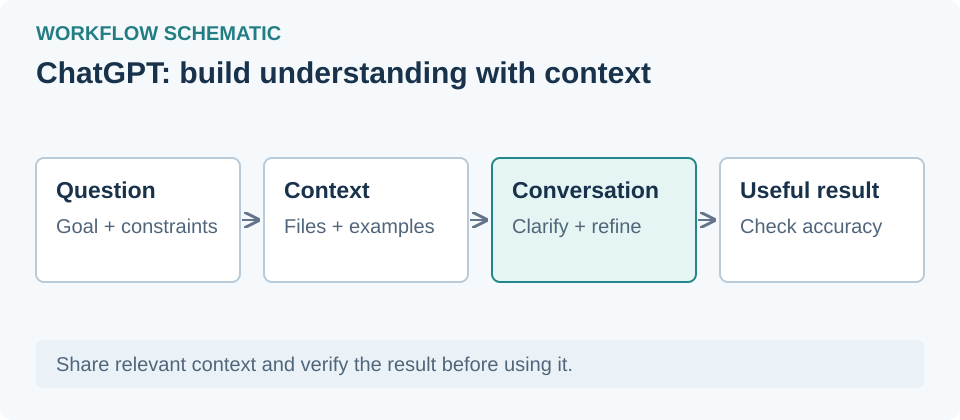

# ChatGPT / Codex

## دسترسی از ایران و محدودیت منطقه‌ای

ایران در [فهرست رسمی کشورهای پشتیبانی‌شدهٔ ChatGPT](https://help.openai.com/en/articles/7947663-chatgpt-supported-countries) نیست؛ بررسی در ۱ نوامبر ۲۰۲۶. برای رفع محدودیت اتصال ممکن است به ابزار عبور از محدودیت شبکه یا پروکسی نیاز باشد. تغییر IP محدودیت منطقه‌ای حساب را برطرف نمی‌کند و خطر مسدودشدن حساب باقی است. دسترسی از ایران آزموده نشده است؛ شرایط Codex و ارائه‌دهندهٔ API را هم جدا بررسی کنید.

## معرفی
اپ دسکتاپ ChatGPT و Codex قدیمی؛ پنل مستقل مدیریت حساب‌های Codex در وایب‌هاب.

## نصب
از [وب‌سایت رسمی](https://chatgpt.com/download/) نسخه ویندوز را نصب کنید؛ سپس فهرست اپ‌ها را تازه‌سازی کنید.

## اجرا و پروکسی
پروفایل انتخابی هنگام اجرای بعدی به برنامه داده می‌شود. برنامه باز را ابتدا خودتان ببندید. عبور تمام ترافیک اپ تضمین نشده است.

## افزونه و اسکیل
در بخش «پلاگین و اسکیل» سازگاری و آموزش نصب را بررسی کنید.

## حساب‌های Codex
پنل «حساب‌های Codex» به VS Code وابسته نیست. برای استفاده، Codex CLI نسخه 0.148.0 لازم است؛ از [راهنمای رسمی](https://learn.chatgpt.com/docs/cli) استفاده کنید. در ترمینال می‌توانید `npm install -g @openai/codex@0.148.0` را اجرا کنید. ورود در مرورگر رسمی انجام می‌شود. این پنل حساب چت معمولی ChatGPT را تغییر نمی‌دهد. اعمال تعویض حساب در اپ ویندوز هنوز تأیید عملی نشده است.
