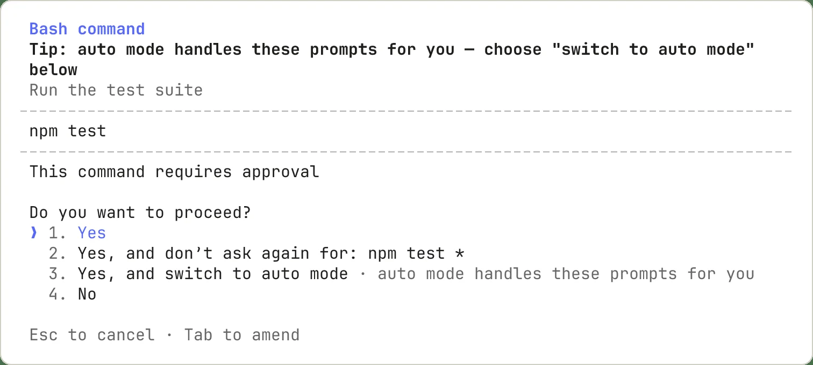

# Claude Code CLI

## What this entry launches
Claude Code runs in a terminal and works on a project. This entry is not Claude Desktop. Use an eligible Claude account or credentials for a compatible API. Connecting another model does not turn it into a Claude model; capabilities, quality and billing depend on that provider.

## Feature learning path
- [Work on a project](/learning/claude-workflow)
- [Planning and permissions](/learning/claude-permissions)
- [Project instructions with CLAUDE.md](/learning/claude-memory)
- [Create and use skills](/learning/claude-skills)
- [Connect tools with MCP](/learning/claude-mcp)
- [Delegate to subagents](/learning/claude-agents)
- [Resume sessions and manage context](/learning/claude-sessions)
- [Reference code and review edits in VS Code](/learning/claude-vscode)
- [Install and manage plugins](/learning/claude-plugins)

## Install and start
Follow the [official Windows setup](https://code.claude.com/docs/en/setup). The official PowerShell installer is:

```powershell
irm https://claude.ai/install.ps1 | iex
```

Open a new terminal and run `claude --version`. If choosing npm, use a supported Node version and `npm install -g @anthropic-ai/claude-code` as documented. Refresh VibeHub to detect the native `.local/bin` installation, npm wrapper or PATH command. For a custom location choose `claude.exe` or `claude.cmd`; the Claude Desktop executable is a different product. Select a project in the Launch tab to open a terminal there.

For the normal account route, run `claude auth login` and complete browser sign-in. The API route below does not need a Claude account, but it needs valid provider credentials and model access.

## Iran and network setup
Iran is absent from the [Claude access list](https://support.claude.com/en/articles/8461763-where-can-i-access-claude). A proxy changes routing, not account eligibility. Other API providers have their own availability and terms.

Claude Code accepts HTTP/HTTPS proxies, not direct SOCKS proxies. Find the **HTTP or Mixed** port in your local proxy application and select an HTTP profile in VibeHub. The example port 10808 was tested on one machine; it is not a universal default:

```powershell
$env:HTTP_PROXY = 'http://127.0.0.1:10808'
$env:HTTPS_PROXY = $env:HTTP_PROXY
$env:NO_PROXY = 'localhost,127.0.0.1,::1'
```

Browser sign-in also requires working browser routing. VibeHub passes the selected settings to the next launched process; existing terminals do not adopt later changes. A successful proxy handshake is not a successful model request. [Network documentation](https://code.claude.com/docs/en/network-config)

## Radeon without a Claude account
Radeon provides Anthropic Messages compatibility. For Claude Code the base is `https://developer.amd.com.cn/radeon/api`, **without `/v1`**: the SDK appends `/v1/messages`. OpenAI-compatible clients instead use the `/api/v1` base. [Radeon Messages documentation](https://amd-aim.github.io/radeon-cloud-docs/api/messages/)

Set these in the same terminal that runs the CLI. The key is entered with a hidden prompt rather than written in a file or command history:

```powershell
$secureKey = Read-Host 'Radeon API key' -AsSecureString
$env:ANTHROPIC_API_KEY = ([pscredential]::new('api', $secureKey)).GetNetworkCredential().Password
$secureKey.Dispose()
$env:ANTHROPIC_AUTH_TOKEN = $null
$env:CLAUDE_CODE_OAUTH_TOKEN = $null
$env:ANTHROPIC_BASE_URL = 'https://developer.amd.com.cn/radeon/api'
$env:ANTHROPIC_DEFAULT_SONNET_MODEL = 'DeepSeek-V4.1-Flash'
$env:ANTHROPIC_DEFAULT_HAIKU_MODEL = 'DeepSeek-V4.1-Flash'
$env:CLAUDE_CODE_SUBAGENT_MODEL = 'DeepSeek-V4.1-Flash'
$env:MAX_THINKING_TOKENS = '0'
claude --model 'DeepSeek-V4.1-Flash'
```

The key remains in this terminal's process environment and its children; close the terminal or run `$env:ANTHROPIC_API_KEY = $null` afterwards. MAX_THINKING_TOKENS=0 prevents budget-based thinking, which Radeon currently rejects. Fetch current model IDs from the service; availability can change. Radeon meters daily usage in points; Claude Code's estimated USD amount is not a Radeon bill.

For direct launch, save a connection in VibeHub and choose it in Claude's Launch panel. VibeHub reads its key from Windows Credential Manager and passes it only to the child process. The hidden-prompt example above is an alternative for manual CLI configuration.

## Other APIs
Use the provider's Anthropic-compatible endpoint and actual model ID. Some gateways require ANTHROPIC_AUTH_TOKEN for a Bearer header, others ANTHROPIC_API_KEY for x-api-key. Avoid configuring conflicting credentials. An OpenAI-compatible endpoint alone is insufficient. [Gateway setup](https://code.claude.com/docs/en/llm-gateway-connect)

[Ollama](https://docs.ollama.com/integrations/claude-code) and [Hugging Face](https://huggingface.co/docs/inference-providers/integrations/claude-code) document their own integrations. Non-Claude model support must be checked with the provider and real tests; Anthropic does not guarantee it.

## Tested setup and troubleshooting
On 2026-11-04, native Claude Code **2.1.318**, the bundled rtl-terminal **1.0.7** and Radeon **DeepSeek-V4.1-Flash** passed a live streaming Persian response, an actual Read-tool round trip and continuation of the same conversation. This process/protocol test does not establish interactive Persian rendering. Qwen3.8-Flash-Next failed with `System message must be at the beginning` on this Claude version. The earlier success with 2.1.63 does not apply to the current plugin requirement. No request instructions were removed or reordered.

- 401: check the key, required header and provider account.
- Model error: use a current Radeon model ID rather than a Claude model name.
- Thinking error: disable budget-based thinking.
- Connection error: check the HTTP port, listener and runtime version.
- Quota or 429: check provider usage and capacity.

Start with a small test project and review tool permissions. A dedicated RTL adapter is not verified for this CLI.

## Persian writing and RTL in Claude
The current Launch panel starts Claude directly in the usual terminal with the bundled rtl-terminal plugin. It does not open RtlTerminal or require copying a command. Claude Code >=2.1.294 is required.

The plugin lays out replies and previews the draft; it cannot redraw Claude's input box. Correct preview alone does not establish acceptable typing. Verify joined letters, ZWNJ, mixed English/numbers, cursor movement, deletion, multiline input, selection, resize and scroll in the actual window. Use `/rtl mode` to inspect the active mode and `/rtl on` to enable layout. Compare `auto`, `claude` and `terminal` only while diagnosing; do not assume one mode fixes shaping.

Use `/copy` for a reply's original logical text. Mouse selection can copy visual order; test it separately. No verified RTL badge is granted. RtlTerminal is a fallback only after the usual terminal demonstrably fails; Quick Input is a separate editor and does not fix an existing CLI draft.

## Direct launch with a selected connection

Choose a model connection in Claude's Launch panel. Manage connections and test models opens the existing connection editor; secrets remain in Windows Credential Manager. Select the gateway's x-api-key or Bearer authentication mode. The endpoint must support Anthropic Messages: an OpenAI-compatible test alone does not establish Claude compatibility.

Run in Persian loads the bundled rendering plugin for this session in the usual terminal, with no command copying. Requires Claude Code >=2.1.294. Run normally uses the same connection without the plugin. The selected connection also applies to subsequent shared card launches. Use existing Claude configuration preserves CLI configuration.

Claude launches without PowerShell profiles or Oh My Posh initialization. Persian rendering remains experimental until cursor, editing and clipboard behavior pass live terminal acceptance.


## Command approval

Claude may ask permission before running tools. This official example shows npm test; approving once differs from allowing future matching commands. See the [permissions lesson](/learning/claude-permissions).


