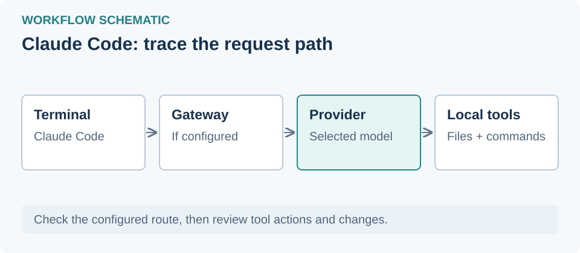

# Claude Code و LiteLLM؛ از شروع کار تا اتصال مدل دیگر



تاریخ بررسی مستندات: **۲۰۲۶-۱۱-۰۱**. این راهنما گزارش نصب موفق یا آزمایش اتصال واقعی نیست.

## ۱. نقش هر ابزار چیست؟

Claude Code دستیار کدنویسی داخل ترمینال است. LiteLLM یک درگاه جداگانه برای مدل‌هاست: **Claude Code ← LiteLLM ← ارائه‌دهندهٔ مدل**. درگاه درخواست‌ها را ترجمه و مسیریابی می‌کند؛ پروکسی شبکه فقط به عبور ترافیک کمک می‌کند و مترجم API نیست.

Anthropic اتصال به درگاه را مستند کرده، اما صریحاً **مسیریابی به مدل‌های غیر Claude را پشتیبانی نمی‌کند**. LiteLLM این مسیر شخص ثالث را مستند کرده است. سازگاری همهٔ مدل‌ها تضمین نیست؛ فراخوانی ابزار، پاسخ جریانی، طول زمینه و رفتار استدلال باید آزمایش شوند. [مستندات Anthropic](https://code.claude.com/docs/en/llm-gateway)، [راهنمای مدل‌های دیگر در LiteLLM](https://docs.litellm.ai/docs/tutorials/claude_non_anthropic_models).

## ۲. نصب روی ویندوز

PowerShell را باز کنید. پس از خواندن [راهنمای رسمی نصب](https://code.claude.com/docs/en/setup)، می‌توانید از روش WinGet استفاده کنید:

```powershell
winget install Anthropic.ClaudeCode
```

ترمینال را دوباره باز کنید و نسخه را ببینید:

```powershell
claude --version
```

برای ابزار Bash، نصب Git for Windows توصیه می‌شود. ابتدا در یک پروژهٔ آزمایشی کار کنید. ورود مستقیم به Claude را فقط با حساب و منطقهٔ واجد شرایط انجام دهید؛ مسیر درگاه از اعتبارنامهٔ درگاه استفاده می‌کند.

## ۳. آماده‌سازی درگاه

برای شروع ساده، از مدیر درگاه آدرس، نام مستعار مدل مجاز و یک کلید مجازی محدود بگیرید. کلید ارائه‌دهنده را در مخزن پروژه نگذارید. برای میزبانی شخصی، [راهنمای LiteLLM](https://docs.litellm.ai/docs/tutorials/claude_non_anthropic_models) را دنبال کنید: پروکسی را نصب کنید، در `model_list` نامی مثل `coding-model` را به شناسهٔ واقعی مدل نگاشت کنید و کلید ارائه‌دهنده را از محیط سرور بخوانید. پیش از اتصال کاربر، احراز هویت و محدودهٔ دسترسی شبکه را تنظیم کنید. هزینه و مجوز ارائه‌دهنده جداست.

## ۴. اتصال در همین نشست PowerShell

از درگاه HTTPS مورد اعتماد استفاده کنید؛ `http://localhost:4000` فقط نمونهٔ درگاه محلی خودتان است. آدرس و نام مدل را عوض کنید. برای نماندن کلید در تاریخچهٔ فرمان، آن را به شکل زیر بخوانید:

```powershell
$env:ANTHROPIC_BASE_URL = 'https://gateway.example.com'
$gatewayCredential = Read-Host 'Gateway virtual key' -AsSecureString
$env:ANTHROPIC_AUTH_TOKEN = [System.Net.NetworkCredential]::new('', $gatewayCredential).Password
Remove-Item Env:ANTHROPIC_API_KEY -ErrorAction SilentlyContinue
$env:ANTHROPIC_MODEL = 'coding-model'
claude
```

متغیرها برای همین نشست و فرایندهای فرزند آن هستند؛ با بستن ترمینال کنار می‌روند. آدرس باید ریشهٔ درگاه باشد، نه مسیر OpenAI مانند `/v1/chat/completions`. نام مدل باید در تنظیمات درگاه موجود و برای کلید شما مجاز باشد. [تنظیم کلاینت LiteLLM](https://docs.litellm.ai/docs/proxy/client_setup/claude_code).

## ۵. آزمون و رفع اشکال

با `/status` آدرس درگاه و منبع اعتبارنامه را ببینید. ابتدا توضیح یک فایل کوچک را بخواهید؛ سپس یک تغییر ساده درخواست کنید و تفاوت فایل را بخوانید. در گزارش درگاه، مدل واقعی مقصد، مصرف و هزینه را بررسی کنید؛ نام مدل در کلاینت به‌تنهایی اثبات مسیر نیست. [بررسی اتصال](https://code.claude.com/docs/en/llm-gateway-connect).

خطای احراز هویت: انقضای کلید و تداخل تنظیمات ورود را بررسی کنید. خطای مدل: نام مستعار و مجوز کلید را تطبیق دهید. اگر گفتگو کار می‌کند ولی ویرایش شکست می‌خورد، فراخوانی ابزار و پاسخ جریانی همان ترکیب کلاینت، درگاه و مدل را آزمایش کنید. تنظیم ناموفق را دائمی نکنید و کلید را در گزارش خطا نگذارید. اجرای برنامه از VibeHub، مسیر واقعی پروکسی و نمایش فارسی ترمینال آزمایش نشده‌اند؛ RTL اختصاصی برای این برنامه نداریم.

## دسترسی از ایران

برای سرویس‌های محدودشده ممکن است راهکار اتصال یا پروکسی لازم شود؛ این کار شرایط منطقه‌ای حساب را تغییر نمی‌دهد و دسترسی را تضمین نمی‌کند. این توضیح به معنی تحریم بودن همهٔ برنامه‌های فهرست نیست. ایران در فهرست مشاهده‌شدهٔ Anthropic نیست، اما [صفحهٔ فعلی](https://www.anthropic.com/legal/supported-regions) تاریخ اجرای **۱۲ نوامبر ۲۰۲۶** دارد که از تاریخ این بررسی جلوتر است. مقررات معتبر در روز استفاده و شرایط ارائه‌دهندهٔ مدل مقصد را بررسی کنید. LiteLLM یا پروکسی این شرایط را حذف نمی‌کنند. اتصال از ایران آزمایش نشده است.
