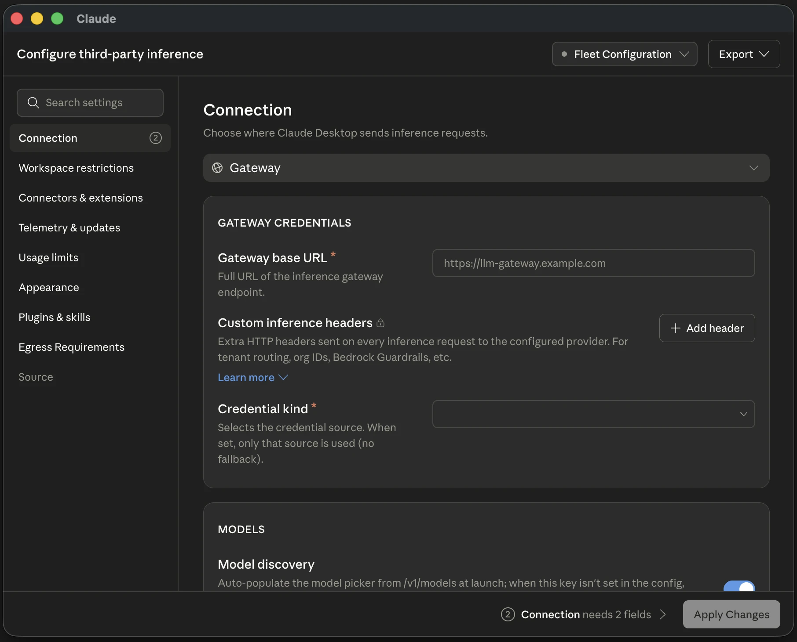

# Claude Desktop

In VibeHub, open the **Claude Desktop** card under **Apps** and select **Guide**. If you still need to install it, find the card under **Discover tools** and select **Official download**. After installation, select **Check again** under **Apps**.

## Add an API model

1. In Claude Desktop, choose **Help → Troubleshooting → Enable Developer Mode**. After the app restarts, open **Developer → Configure Third-Party Inference**.
2. Under **Connection**, choose **Claude API** for an Anthropic API key. For a gateway, choose **Gateway** and enter its base URL, key, and auth scheme (`Bearer` or `x-api-key`) as documented by the gateway. Enter the base URL. Claude Desktop appends `/v1/messages`.
3. In **Models → Model list**, add the exact model ID. If the gateway serves `GET /v1/models`, Claude Desktop can discover recognizable Claude IDs. Enter the full model ID manually for a routing alias or if discovery returns an empty list.
4. Select **Test Connection**, then **Apply Changes**. If Claude offers to start with the inference configuration, choose that option.



The gateway must serve `POST /v1/messages` with streaming and tool use. An OpenAI-only API needs a gateway that translates requests and responses. Anthropic officially supports Claude models through this route. CLI settings and VibeHub’s saved API reference are separate from the connection configured in Claude Desktop.

[In-app configuration](https://claude.com/docs/third-party/claude-desktop/in-app-configuration) · [Gateway and model requirements](https://claude.com/docs/third-party/claude-desktop/gateway#models)

## Test the model in Code

Open a local **Code** session in a test folder and select the model. First ask it to reply only with `API_OK`. Then place a `probe.txt` file with dummy text in the folder and ask the model to read it with its file tool and return the contents. Approve the read if prompted. The first reply checks generation. The file read and its tool event check tool use. If your gateway has request logs, check the model ID there too.

If **Test Connection** succeeds but a session fails, check the model ID, the key’s access to that model, and gateway support for streaming and tool use. When connecting from Iran, check network access to the configured endpoint separately from model permissions and quota.

## Fix the Cowork reinstall prompt on Windows

If Cowork says **Reinstall the desktop app to access Cowork**, open **Help → Troubleshooting → Show Logs** and inspect the feature checks. `msix_required` appears when Claude runs from an installation such as Squirrel and Cowork requires the MSIX edition. Run the official Windows installer and approve the administrator (**UAC**) prompt.

If the installer still opens the older copy, download the official **MSIX** for your architecture (`x64` or `ARM64`) from the Windows deployment guide. Open **Windows PowerShell** with **Run as administrator** and replace the example path with the path to the downloaded file.

```powershell
Add-AppxPackage -Path 'C:\path\to\Claude.msix'
```

After installation, open **Claude** from Start or from the **Claude Desktop** card in VibeHub. These commands check package registration for the current Windows user and the Cowork service.

```powershell
Get-AppxPackage -Name Claude | Select-Object Name, Version, Status
Get-Service -Name CoworkVMService
```

Look for the `Claude` package with status `Ok`. While using Cowork, check for a `Running` service. If the MSIX copy reports a virtualization or missing HCS service error, follow Anthropic’s guide to check **Virtual Machine Platform**. If it is disabled, run `Enable-WindowsOptionalFeature -Online -FeatureName VirtualMachinePlatform -All -NoRestart` in administrator PowerShell, save your work, and use Windows **Restart**.

[Official download](https://claude.com/download) · [Windows installation and Cowork troubleshooting](https://support.claude.com/en/articles/12622703-deploy-claude-desktop-for-windows)

## Test command execution in Cowork

The first local Cowork session may download the VM workspace from `downloads.claude.ai`. If **Test Connection** passes and the model can reply or read files, but a command reports that the workspace is downloading, let the download finish. If progress stalls, check network access to `downloads.claude.ai`. The model gateway and workspace download use separate endpoints.

After the download, ask a local Cowork session to run `printf 'COWORK_VM_OK\n'` in the Cowork environment and return its output. Check the **Activity** panel for a successful command event and the output `COWORK_VM_OK`. This verifies that the shell in the Cowork VM can run commands.

[Execution and network access in Claude Desktop](https://claude.com/docs/third-party/claude-desktop/overview)
