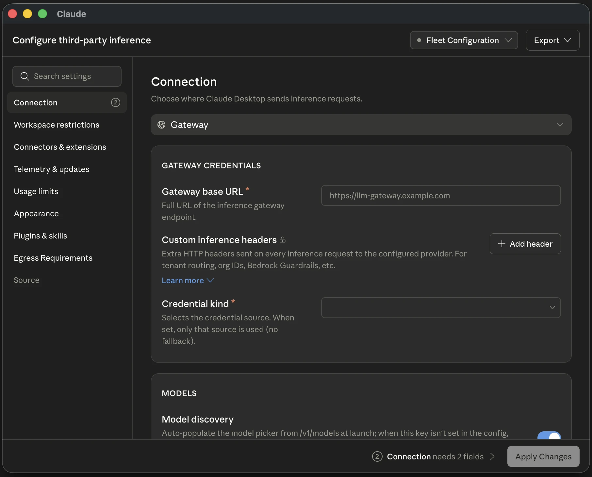

# Claude Desktop

در بخش **برنامه‌ها** در وایب‌هاب، کارت **Claude Desktop** را باز کنید و به تب **راهنما** بروید. اگر هنوز آن را نصب نکرده‌اید، از **کشف ابزارها** کارت Claude Desktop را باز کنید و **دانلود رسمی** را بزنید. پس از نصب، در فهرست برنامه‌ها **بررسی مجدد** را بزنید.

## اضافه کردن مدل API

1. در Claude Desktop از منوی **Help → Troubleshooting → Enable Developer Mode** حالت توسعه‌دهنده را روشن کنید. پس از باز شدن دوبارهٔ برنامه، **Developer → Configure Third-Party Inference** را باز کنید.
2. در بخش **Connection** برای کلید Anthropic گزینهٔ **Claude API** را انتخاب کنید. اگر درگاه دارید، **Gateway** را بزنید و **Gateway base URL**، کلید درگاه و نوع احراز هویت (`Bearer` یا `x-api-key`) را مطابق مستندات همان درگاه وارد کنید. نشانی پایه را وارد کنید. برنامه مسیر `/v1/messages` را به آن اضافه می‌کند.
3. در **Models → Model list** شناسهٔ دقیق مدل را اضافه کنید. اگر درگاه `GET /v1/models` دارد، Claude Desktop می‌تواند شناسه‌های قابل‌شناسایی Claude را خودش پیدا کند. برای نام مستعار درگاه یا فهرست خالی، شناسهٔ کامل مدل را دستی وارد کنید.
4. **Test Connection** را بزنید و سپس با **Apply Changes** تنظیمات را اعمال کنید. اگر برنامه گزینهٔ استفاده از تنظیمات inference را نشان داد، با همان گزینه ادامه دهید.



درگاه باید `POST /v1/messages`، استریم و فراخوانی ابزارها را پشتیبانی کند. اگر ارائه‌دهنده فقط API سازگار با OpenAI دارد، یک درگاه تبدیل لازم است. Anthropic مدل‌های غیر Claude را رسماً پشتیبانی نمی‌کند. تنظیم اتصال CLI یا انتخاب مرجع API در وایب‌هاب، تنظیم اتصال Claude Desktop را تغییر نمی‌دهد.

[تنظیم داخل برنامه](https://claude.com/docs/third-party/claude-desktop/in-app-configuration) · [فهرست مدل‌ها و سازگاری درگاه](https://claude.com/docs/third-party/claude-desktop/gateway#models)

## تست مدل در تب Code

در **Code** یک نشست محلی در پوشهٔ آزمایشی باز کنید و مدل را از فهرست انتخاب کنید. اول بفرستید «فقط بنویس `API_OK`». سپس در همان پوشه یک فایل `probe.txt` با محتوای ساختگی بگذارید و از مدل بخواهید فایل را با ابزار خواندن فایل باز کند و محتوایش را برگرداند. در صورت نیاز، اجازهٔ خواندن همان فایل را بدهید. پاسخ اول تولید متن و پاسخ دوم همراه با رویداد خواندن فایل، کار کردن ابزار را بررسی می‌کند. اگر درگاه لاگ درخواست دارد، شناسهٔ مدل را در آن هم بررسی کنید.

اگر **Test Connection** موفق شد ولی مدل در نشست خطا داد، شناسهٔ مدل، مجوز کلید و پشتیبانی درگاه از استریم و ابزارها را بررسی کنید. برای استفاده از ایران، دسترسی شبکه به نشانی درگاه را از مجوز مدل یا سهمیهٔ کلید جدا بررسی کنید.

## رفع پیام نصب دوبارهٔ Cowork در ویندوز

اگر Cowork پیام **Reinstall the desktop app to access Cowork** می‌دهد، از **Help → Troubleshooting → Show Logs** وضعیت قابلیت‌ها را بررسی کنید. خطای `msix_required` زمانی دیده می‌شود که Claude از نصبی مانند Squirrel اجرا شده و Cowork به نسخهٔ MSIX نیاز دارد. نصب‌کنندهٔ رسمی ویندوز را اجرا کنید و درخواست دسترسی مدیر (**UAC**) را تأیید کنید.

اگر نصب‌کننده همان نسخهٔ قبلی را باز کرد، بستهٔ رسمی **MSIX** را متناسب با معماری دستگاه (`x64` یا `ARM64`) از راهنمای ویندوز بگیرید. **Windows PowerShell** را با **Run as administrator** باز کنید. در دستور زیر مسیر نمونه را با مسیر فایل دانلودشده جایگزین کنید.

```powershell
Add-AppxPackage -Path 'C:\path\to\Claude.msix'
```

بعد از نصب، **Claude** را از منوی **Start** یا از کارت **Claude Desktop** در وایب‌هاب باز کنید. این دو دستور به‌ترتیب ثبت بسته برای حساب فعلی و وضعیت سرویس Cowork را نشان می‌دهند.

```powershell
Get-AppxPackage -Name Claude | Select-Object Name, Version, Status
Get-Service -Name CoworkVMService
```

در خروجی اول دنبال بستهٔ `Claude` با وضعیت `Ok` بگردید. هنگام اجرای Cowork، وضعیت سرویس را بررسی کنید که `Running` باشد. اگر پیام خطای مجازی‌سازی یا سرویس‌های HCS گرفتید، طبق راهنمای Anthropic وضعیت **Virtual Machine Platform** را بررسی کنید. اگر غیرفعال است، در PowerShell با دسترسی مدیر `Enable-WindowsOptionalFeature -Online -FeatureName VirtualMachinePlatform -All -NoRestart` را اجرا کنید و بعد از ذخیرهٔ کارها، ویندوز را **Restart** کنید.

[دانلود رسمی](https://claude.com/download) · [نصب و عیب‌یابی Cowork در ویندوز](https://support.claude.com/en/articles/12622703-deploy-claude-desktop-for-windows)

## تست اجرای فرمان در Cowork

اولین نشست محلی Cowork ممکن است بستهٔ محیط ماشین مجازی را از `downloads.claude.ai` دانلود کند. اگر **Test Connection** سبز است و مدل پاسخ می‌دهد یا فایل می‌خواند، ولی فعالیت اجرای فرمان پیام دانلود محیط را نشان می‌دهد، بگذارید دانلود تمام شود. اگر پیشرفت متوقف شده، دسترسی شبکه به `downloads.claude.ai` را بررسی کنید. اتصال به درگاه مدل و دانلود محیط از دو مقصد جدا انجام می‌شوند.

پس از دانلود، در یک نشست محلی Cowork از مدل بخواهید فرمان `printf 'COWORK_VM_OK\n'` را در محیط Cowork اجرا کند و خروجی را برگرداند. در پنل **Activity**، رویداد موفق اجرای فرمان و خروجی `COWORK_VM_OK` را بررسی کنید. این تست بالا آمدن محیط اجرای فرمان را تأیید می‌کند.

[محیط اجرا و دسترسی شبکه در Claude Desktop](https://claude.com/docs/third-party/claude-desktop/overview)
