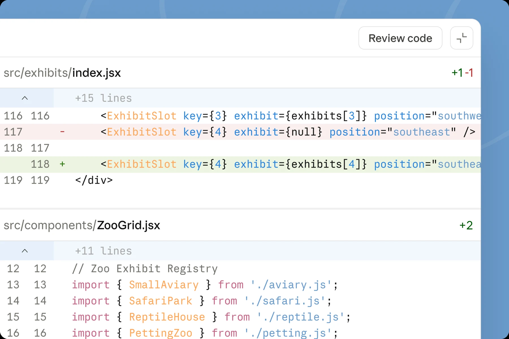

# شروع کار با Claude Desktop و Code

## نصب و اجرای Code

[Claude Desktop را از وب‌سایت رسمی نصب کنید](https://claude.com/download). در وایب‌هاب دکمهٔ تازه‌سازی را بزنید؛ اگر پیدا نشد، مسیر Claude.exe را انتخاب کنید. Claude را اجرا و با حساب خود وارد شوید. زبانهٔ Code را باز کنید، پوشهٔ پروژه را انتخاب کنید و درخواست خود را بنویسید. پیش از تأیید، تغییرات و فرمان‌ها را بررسی کنید. دسترسی Code به طرح حساب و شرایط Anthropic وابسته است. [راهنمای رسمی](https://code.claude.com/docs/en/desktop).

## بازبینی تغییرات محلی

در تب Code، نمای تغییرات را باز کنید تا فایل‌های ویرایش‌شده را ببینید. گزینهٔ Review code را بزنید تا کلاد کنار تغییرات نظر بگذارد. سپس تصمیم بگیرید کدام پیشنهادها را اعمال کنید. [راهنمای رسمی بازبینی در نسخهٔ دسکتاپ](https://claude.com/resources/articles/preview-review-and-merge-with-claude-code).

## استفاده از API و مدل‌های دیگر

اتصال مدل دیگر در تب Code دسکتاپ به تنظیمات سازمانی و پشتیبانی Anthropic وابسته است؛ انتخاب یک API در وایب‌هاب آن را خودکار به Claude متصل نمی‌کند. مستندات Anthropic اتصال دروازه و Vertex را برای استقرار سازمانی شرح می‌دهد. برای Bedrock و Foundry از Claude Code خط فرمان استفاده کنید. [مستندات دسکتاپ](https://code.claude.com/docs/en/desktop).

برای آزمایش مدل‌های غیر Claude در خط فرمان، راهنمای [Claude Code و LiteLLM](https://github.com/ahmadkhanloo/VibeHub/blob/main/docs/tutorials/claude-code/fa.md) را بخوانید: کلید محدود درگاه، آدرس و نام مدل را در نشست PowerShell تنظیم کنید و سپس اتصال، پاسخ جریانی و ابزارها را جداگانه بررسی کنید. این مسیر شخص ثالث است و پشتیبانی همهٔ مدل‌ها یا کارکرد در دسکتاپ را تضمین نمی‌کند. کلید را در مخزن یا گزارش خطا قرار ندهید.
