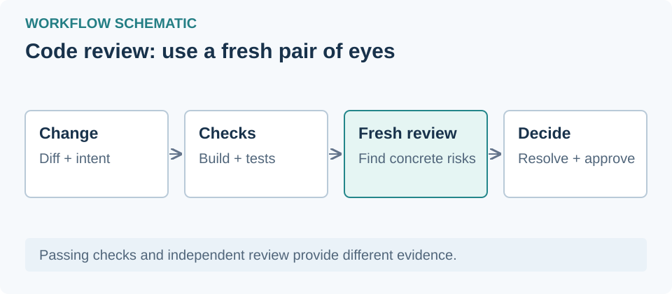

# بازبینی کد با کمک ایجنت

## مسیر تغییر تا انتشار

بررسی محلی → بازبینی هوش مصنوعی → امنیت → آزمون و ساخت → تأیید انسانی → انتشار تدریجی → پایش و بازگردانی

## 1. پیش از درخواست ادغام

تست، بررسی نوع‌ها و build پروژه را اجرا کنید و خروجی را نگه دارید. فایل CLAUDE.md کوتاهی از فرمان‌ها و قواعد پروژه بسازید. سپس در Claude Code فرمان‌های /code-review و /security-review را اجرا کنید.

## 2. قواعد بازبینی را بنویسید

در REVIEW.md خطاهای مهم، مسیرهای حساس و موارد قابل چشم‌پوشی را مشخص کنید. از بازبین بخواهید برای هر ایراد فایل، خط و دلیل ارائه کند. ایرادهای تکراری را به قواعد یا lint منتقل کنید.

## 3. در هر درخواست ادغام

بازبینی خودکار کد و امنیت و بررسی‌های CI را فعال کنید. هر ایراد را رفع کنید یا با دلیل ببندید. در توضیح درخواست، روش آزمون، ریسک و روش بازگردانی را بنویسید.

## 4. تأیید را با ریسک تنظیم کنید

از قواعد سخت‌گیرانه شروع کنید. برای تغییرات حساس مانند احراز هویت، پرداخت، CI و انتشار، بازبینی انسانی و حفاظت شاخه بگذارید. تأیید ربات جای تأیید انسان را نمی‌گیرد؛ پس از تغییر commit تأیید را دوباره بررسی کنید.

## 5. منتشر و پایش کنید

در صورت امکان از صف ادغام، feature flag و انتشار مرحله‌ای استفاده کنید. راه بازگردانی سریع داشته باشید. رخدادها و revertها را به نمونه‌های آزمون بازبین اضافه کنید و نرخ آن‌ها را کنار زمان بازبینی بسنجید.

## 6. از چرخهٔ بی‌پایان جلوگیری کنید

پس از سه دور بازبینی، رویکرد را دوباره ارزیابی کنید. در دورهای بعد فقط تغییرات جدید را بررسی کنید و ایرادهای تکراری را دوباره گزارش نکنید.

## الگوی آماده برای درخواست بازبینی

اگر از سرویس Claude استفاده می‌کنید، وضعیت منطقهٔ حساب را بررسی کنید. محدودیت اتصال از ایران ممکن است به ابزار عبور از محدودیت شبکه یا پروکسی نیاز داشته باشد؛ این کار محدودیت حساب را برطرف نمی‌کند. [صفحهٔ مناطق Anthropic](https://www.anthropic.com/legal/supported-regions) هنگام بررسی ۱ نوامبر، تاریخ اجرای ۱۲ نوامبر ۲۰۲۶ داشت؛ وضعیت معتبر روز استفاده را بررسی کنید.

> تغییرات فعلی را نسبت به هدف درخواست و کد اطراف بررسی کن. خطاهای واقعی، ریسک امنیتی و موارد آزمون‌نشده را با فایل، شماره خط و دلیل گزارش کن. خروجی تست و محدودیت بررسی را مشخص کن؛ ایرادهای صرفاً ظاهری را حذف کن. هیچ تغییری را بدون بررسی من ادغام نکن.

[منبع: مقالهٔ تیم Claude Code](https://claude.dev/blog/solving-code-review-at-anthropic/)
