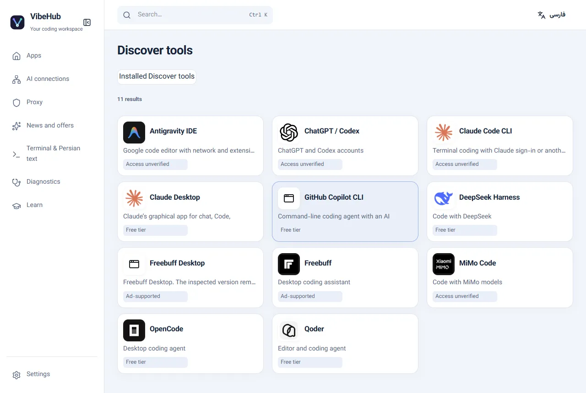

# GitHub Copilot CLI

Install PowerShell 7, then install the official CLI:

`winget install GitHub.Copilot`

Refresh VibeHub and launch Copilot CLI. Use `/login` to sign in to GitHub. Copilot Free includes a limited AI Credits allowance, subject to account and organization policies.

[Official installation guide](https://docs.github.com/en/copilot/how-tos/copilot-cli/set-up-copilot-cli/install-copilot-cli)

