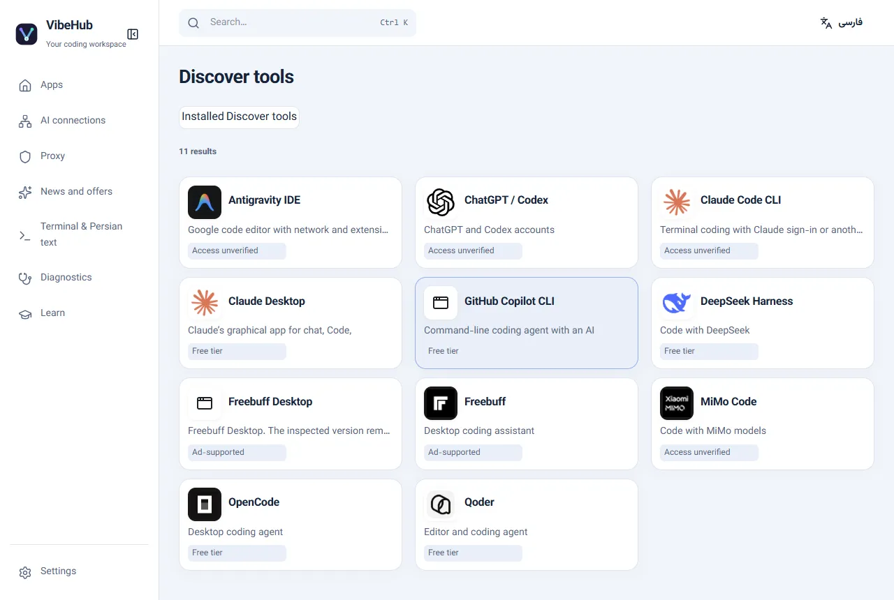

# GitHub Copilot CLI

ابتدا PowerShell 7 را نصب کنید و سپس فرمان زیر را اجرا کنید:

`winget install GitHub.Copilot`

در VibeHub فهرست برنامه‌ها را تازه‌سازی و Copilot CLI را اجرا کنید. برای ورود به GitHub از `/login` استفاده کنید. طرح Copilot Free سهمیهٔ محدود AI Credits دارد و دسترسی به سیاست حساب و سازمان وابسته است.

[راهنمای رسمی نصب](https://docs.github.com/en/copilot/how-tos/copilot-cli/set-up-copilot-cli/install-copilot-cli)

