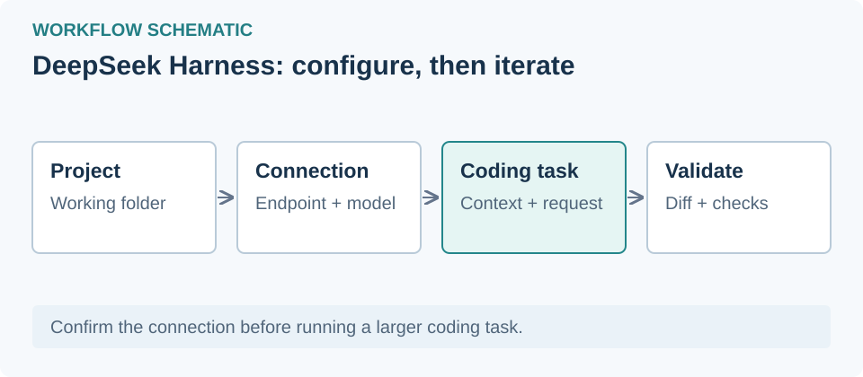

# DeepSeek Harness — English guide

## Introduction
DeepSeek Harness is the desktop client for the DeepSeek agent. VibeHub detects it, launches it, and applies RTL.

## Free access
- Under DeepSeek's current terms; verify quotas in official sources.
- Not open source.

## Install
Install from the official source (standard folder `Programs\DeepSeek Harness`); VibeHub searches that path.

## First run
**Launch with RTL** → VibeHub opens port 9228, confirms a real `dsh-app://` window, and activates the injection.

## Proxy & Iran access
Not tested. If connections fail, set your local proxy profile in the Proxy Center.

## RTL
Verified (live test 2026-10-18, version 0.2.1-rc.2). The Vazirmatn font is injected with the stylesheet.

## Troubleshooting
- App open without the port: fully quit and relaunch.
- Port open but no dsh window: wait a few seconds; VibeHub waits up to 30 s and then reports a clear error.

## Model options
Follows the DeepSeek service; BYOK unknown until tested.

## Intermediate: web login and free model allowances

Read **DeepSeek 网页登录（免费模型）** in [Learning](/learning/dsh-deepseek-web-login). The [shared skill guide](/learning/skill-basics) covers common compatibility and removal steps. [Plugin source](https://github.com/cv-superding/dsh-deepseek-web-login)

This uses a Web account allowance, not unlimited free official API access. Documentation checked November 1, 2026; installation and authenticated use remain untested.

## Shared RTL setup

See the [Persian text and RTL guide](/learning/rtl-setup) for common installation, launch and recovery steps. This app's verification status remains in the RTL section above.
