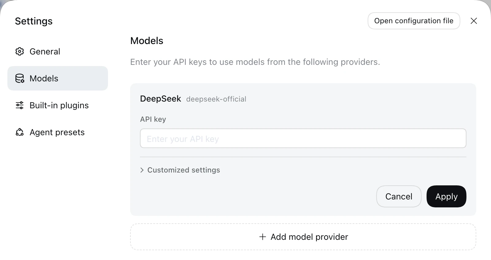
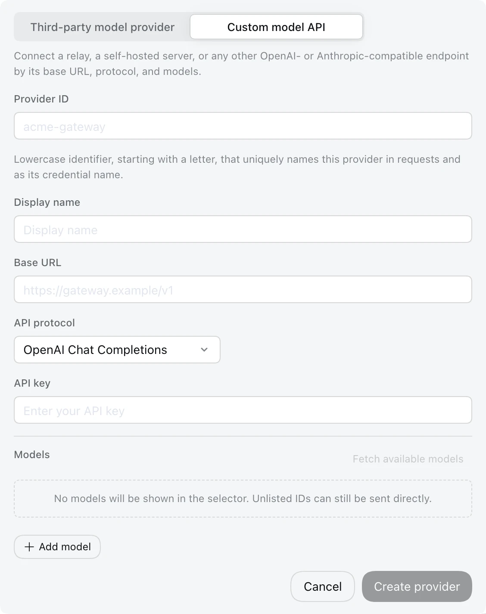

# DeepSeek Harness — راهنمای فارسی

## معرفی
DeepSeek Harness کلاینت دسکتاپ ایجنت DeepSeek است. VibeHub آن را تشخیص می‌دهد، اجرا و RTL می‌کند.

## دسترسی رایگان
- طبق شرایط جاری DeepSeek؛ سهمیه‌ها را در منابع رسمی بررسی کنید.
- وضعیت کد و مجوز را در [مخزن رسمی Harness](https://github.com/deepseek-ai/deepseek-harness) بررسی کنید؛ شرایط دسترسی به مدل از مجوز نرم‌افزار جداست.

## نصب
از منبع رسمی نصب کنید (پوشهٔ استاندارد `Programs\DeepSeek Harness`). VibeHub همین مسیر را جست‌وجو می‌کند.

## اولین اجرا
«اجرا با RTL» → VibeHub پورت 9228 را باز می‌کند، وجود پنجرهٔ واقعی (`dsh-app://`) را تأیید و تزریق را فعال می‌کند.

## پروکسی و دسترسی از ایران
آزمون‌نشده. در صورت خطای اتصال، پروفایل پروکسی محلی خود را در مرکز پروکسی تنظیم کنید.

## RTL
تأییدشده (آزمون زندهٔ ۲۰۲۶/۱۰/۱۸، نسخهٔ 0.2.1-rc.2). فونت Vazirmatn همراه تزریق بارگذاری می‌شود.

## عیب‌یابی
- اگر برنامه بدون پورت باز باشد: بستن کامل و اجرای دوباره.
- اگر پورت باز بود ولی پنجرهٔ dsh نیامد: چند ثانیه صبر کنید؛ VibeHub تا ۳۰ ثانیه منتظر می‌ماند و بعد خطای شفاف می‌دهد.

## گزینه‌های مدل
از سرویس DeepSeek پیروی می‌کند؛ BYOK وضعیت نامشخص تا آزمون.

## آموزش تکمیلی: ورود وب و مدل‌های رایگان

آموزش **DeepSeek 网页登录（免费模型） — ورود وب دیپ‌سیک** را در [بخش یادگیری](/learning/dsh-deepseek-web-login) ببینید. راهنمای مشترک سازگاری و حذف افزونه‌ها در [راهنمای پایهٔ اسکیل‌ها](/learning/skill-basics) است. [مخزن افزونه](https://github.com/cv-superding/dsh-deepseek-web-login)

این مسیر از سهمیهٔ حساب وب استفاده می‌کند؛ API رسمی رایگان نامحدود نیست. مستندات در ۱ نوامبر ۲۰۲۶ بررسی شده‌اند؛ نصب و ورود واقعی آزموده نشده است.

## راه‌اندازی مشترک RTL

مراحل نصب، اجرا و رفع خطای مشترک برنامه‌های پشتیبانی‌شده در [راهنمای فارسی‌نویسی و RTL](/learning/rtl-setup) آمده است. وضعیت تأیید همین برنامه در بخش RTL بالا آمده است.

## تمرین تصویری: تنظیم مدل در Harness

در Settings → Models کارت DeepSeek را باز کنید. کلید API را فقط در فیلد تنظیمات وارد و ذخیره کنید؛ خالی‌بودن فیلد در تصویر به معنی نداشتن کلید ذخیره‌شده نیست. طبق راهنمای رسمی، کلید ذخیره‌شده به رابط برگردانده نمی‌شود.

برای سرویس دیگر، Add model provider را باز کنید. اگر سرویس در فهرست آماده نیست، Custom model API را انتخاب و Provider ID، نشانی، پروتکل API، کلید و مدل را طبق مستندات همان سرویس تکمیل کنید. OpenAI Chat Completions، OpenAI Responses و Anthropic Messages را با هم اشتباه نگیرید.

پس از ذخیره، مدل را در گفتگو انتخاب کنید و در یک پروژهٔ آزمایشی درخواست فقط‌خواندنی بدهید. نمایش تنظیمات یا تشخیص کلید، موفقیت اتصال و مجوز استفاده از مدل را ثابت نمی‌کند. این تصاویر از راهنمای رسمی رابط وب Harness هستند؛ چیدمان نسخهٔ دسکتاپ نصب‌شدهٔ شما ممکن است متفاوت باشد.

[راهنمای رسمی تنظیم مدل](https://github.com/deepseek-ai/deepseek-harness/blob/master/docs/user/guide/providers.md)
