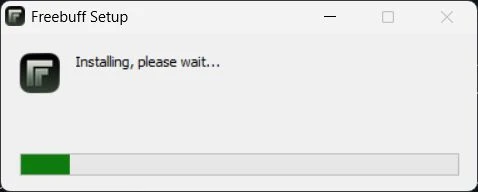
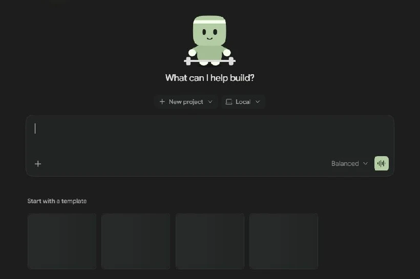

# Freebuff Desktop — English guide

## Introduction

Freebuff Desktop is the official desktop client and has a separate identity and launch path from Freebuff CLI, which runs in a terminal. The official page lists macOS (Apple Silicon and Intel), Windows (64-bit, ARM64, and older-PC builds), and Linux (deb and AppImage for x86_64 and ARM64).

## Install

Download the build for your OS and architecture from the [official Freebuff Desktop page](https://freebuff.com/desktop). On November 2, 2026, its official Windows route returned Freebuff-0.0.196-win-x64.exe; check the installer signature before running it.

## First run

Open the app installed by the official installer and follow its own sign-in flow. VibeHub does not modify the installed app files, and RTL is unavailable for Freebuff Desktop in this version.

## Persian and RTL

The renderer structure and message surface have not been inspected in an installed copy. Therefore VibeHub injects no selectors or direction/font changes into the app. RTL can be enabled only after observing and testing the actual renderer for a specific build.

## Freebuff CLI is separate

Freebuff CLI runs in a terminal through the official `freebuff` command and keeps the VibeHub catalog ID `freebuff`. This guide covers the separate desktop product with ID `freebuff-desktop`; changing CLI terminal output is outside this app's RTL scope.

## Illustrated installation and first chat

Run the official Windows installer and wait for the progress bar to finish.

Open a new chat in Code. Use New project to choose a disposable folder and check that Local is selected. Ask “Explain README.md without changing it,” then compare the answer with the file.

