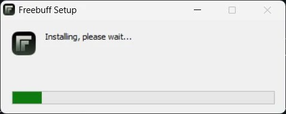
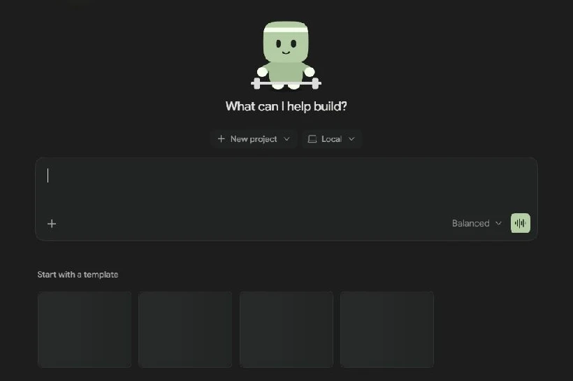

# Freebuff Desktop — راهنمای فارسی

## معرفی

Freebuff Desktop نسخهٔ رسمی دسکتاپ Freebuff است و از Freebuff CLI که در ترمینال اجرا می‌شود شناسه و مسیر جداگانه‌ای دارد. صفحهٔ رسمی نسخه‌های macOS (Apple Silicon و Intel)، Windows (۶۴بیتی، ARM64 و رایانه‌های قدیمی) و Linux (deb و AppImage برای x86_64 و ARM64) را فهرست می‌کند.

## نصب

از [صفحهٔ رسمی Freebuff Desktop](https://freebuff.com/desktop) نسخهٔ متناسب با سیستم‌عامل و معماری را بگیرید. مسیر رسمی دانلود Windows در ۲ نوامبر ۲۰۲۶ فایل Freebuff-0.0.196-win-x64.exe را ارائه کرد؛ امضای آن باید پیش از اجرای نصب‌کننده جداگانه بررسی شود.

## اولین اجرا

برنامه را از نصب‌کنندهٔ رسمی باز کنید و طبق راهنمای خود برنامه وارد حساب شوید. در این نسخه، VibeHub فایل‌های برنامه را تغییر نمی‌دهد و RTL برای Freebuff Desktop در دسترس نیست.

## فارسی و RTL

ساختار renderer و سطح پیام این برنامه در یک نسخهٔ نصب‌شده بررسی نشده است. به همین دلیل هیچ انتخابگر یا تغییر جهت/فونتی برای برنامه تزریق نمی‌شود. قابلیت RTL فقط پس از مشاهدهٔ renderer واقعی و آزمون همان نسخه اعلام خواهد شد.

## تفاوت با Freebuff CLI

Freebuff CLI با فرمان رسمی `freebuff` در ترمینال اجرا می‌شود و کاتالوگ VibeHub آن را با شناسهٔ `freebuff` نگه می‌دارد. این راهنما مربوط به برنامهٔ دسکتاپ با شناسهٔ مستقل `freebuff-desktop` است؛ خروجی ترمینال CLI در محدودهٔ RTL این برنامه نیست.

## نصب و اولین گفت‌وگو با تصویر

پس از اجرای نصب‌کنندهٔ رسمی ویندوز صبر کنید تا نوار نصب کامل شود.

در تب Code گفت‌وگوی تازه باز کنید. با New project یک پوشهٔ آزمایشی انتخاب کنید و حالت Local را بررسی کنید. در کادر درخواست بنویسید «فقط README.md را توضیح بده» و پس از دریافت پاسخ آن را با فایل مقایسه کنید.

