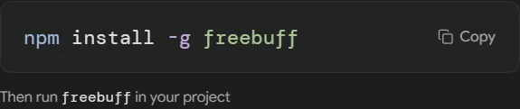

# Freebuff — English guide

## Introduction
Freebuff (correct spelling; not the unrelated FreeBuf security-news site) is a coding agent with Apache-2.0 code and ad-supported free model access in official clients.

## Free access
- Free use is supported in the official CLI/Desktop/Web clients via ads.
- The [terms of service](https://freebuff.com/terms-of-service) forbid connecting to private/unofficial endpoints, bot access/request replay, and misrepresenting your location for unauthorized benefits. VibeHub does none of this and offers no button for it.
- Read the [privacy policy](https://freebuff.com/privacy-policy).

## Install
Only from the [official repo/site](https://github.com/CodebuffAI/freebuff). VibeHub detects the official CLI command.

## First run
**Open in Terminal**. RTL status: unknown.

## Proxy & Iran access
Not tested. **Note:** using a proxy to circumvent geographic/quota limits violates the terms; VibeHub presents proxy purely as your local network setting and never recommends terms violations.

## Troubleshooting
- Quota/location errors: read the service message; the fix is never a bypass.

## Model options
Per the official service; BYOK unknown until tested.

## Illustrated terminal exercise

Copy the installation command from the official CLI page and run it in your terminal. Then open a disposable project folder and run `freebuff`.

Ask Freebuff to explain hello.txt without editing it. Check the session folder and selected model. If the command is missing, open a new terminal and check your npm install path. The screenshot shows the installation step on the official website.
