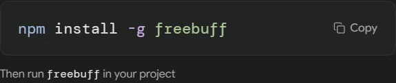

# Freebuff — راهنمای فارسی

## معرفی
Freebuff (با املای درست؛ نه FreeBuf سرویس اخبار امنیتی) ایجنت کدنویسی با کد Apache-2.0 و دسترسی مدل رایگانِ تبلیغ‌پشتیبانی در کلاینت‌های رسمی است.

## دسترسی رایگان
- استفادهٔ رایگان در کلاینت‌های رسمی CLI/Desktop/Web با تبلیغات پشتیبانی می‌شود.
- [شرایط استفاده](https://freebuff.com/terms-of-service): اتصال به Endpointهای خصوصی/غیررسمی، دسترسی رباتیک/بازپخش درخواست‌ها، و جازدن موقعیت جغرافیایی برای مزایای نامجاز **ممنوع** است. VibeHub این کارها را انجام نمی‌دهد و دکمه‌ای برایشان ندارد.
- [سیاست حریم خصوصی](https://freebuff.com/privacy-policy) را بخوانید.

## نصب
فقط از [مخزن/سایت رسمی](https://github.com/CodebuffAI/freebuff). VibeHub فرمان رسمی CLI را تشخیص می‌دهد.

## اولین اجرا
«باز کردن در ترمینال». وضعیت RTL: نامشخص.

## پروکسی و دسترسی از ایران
آزمون‌نشده. **توجه:** استفاده از پروکسی برای دور زدن محدودیت جغرافیایی/سهمیه خلاف شرایط است؛ VibeHub پروکسی را فقط به‌عنوان تنظیم شبکهٔ محلی کاربر ارائه می‌کند و توصیهٔ نقض شرایط نمی‌دهد.

## عیب‌یابی
- خطای سهمیه/موقعیت: پیام سرویس را ببینید؛ راه‌حل، دور زدن نیست.

## گزینه‌های مدل
طبق سرویس رسمی؛ BYOK نامشخص تا آزمون.

## تمرین تصویری در ترمینال

در صفحهٔ رسمی CLI فرمان نصب را کپی کنید و در ترمینال اجرا کنید. سپس وارد پوشهٔ یک پروژهٔ آزمایشی شوید و `freebuff` را بزنید.

در نشست Freebuff بخواهید فایل hello.txt را توضیح دهد و چیزی را تغییر ندهد. پوشه و مدل نشست را بررسی کنید. اگر فرمان پیدا نشد، ترمینال تازه‌ای باز کنید و مسیر نصب npm را بررسی کنید. تصویر، مرحلهٔ نصب از سایت رسمی را نشان می‌دهد.
