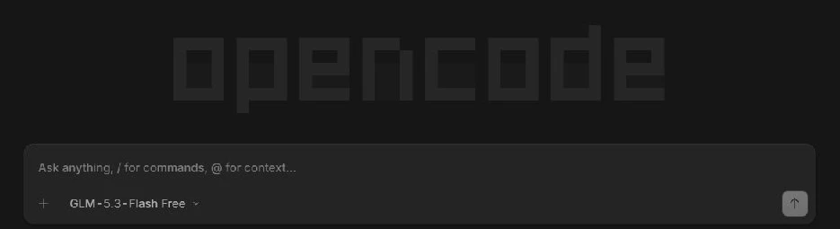

# Getting started with VibeHub

Suggested time: 15–20 minutes

By the end you can install VibeHub, detect a coding app, and start your first small task.

## 1. Install VibeHub

Get `VibeHub-Setup.exe` from the [GitHub releases](https://github.com/ahmadkhanloo/VibeHub/releases) and run it. The "Full VibeHub" choice installs the hub plus the RTL launchers. The installer does not touch your system Node and downloads nothing in the background.

Open VibeHub when the install finishes. The first run picks a language and goes straight to the workspace; the setup guide stays optional.

## 2. Install and detect a coding app

If you have no app yet, pick one from the catalog and install it from its official source; free-tier apps with daily credit are enough to start. Then press **Refresh** in VibeHub.

Detected apps appear in the Installed list. If yours is missing, select its executable on the app's page.

## 3. Read that app's guide

Accounts, models, and access differ by service. Open the guide for the app you use and check current conditions with its official source. For API access, the API notebook is a manual setup reference and never rewrites the target app's settings.

## 4. Try a small task

Try building a single-file HTML page in a practice folder. The next lesson walks through the exercise.

Before accepting any change, read the file diff yourself, and keep API keys and login details out of project files and reports.

## Persian text

RTL support depends on each app, and installing files alone does not prove correct rendering. For terminal, font, and right-to-left launch setup, read [Persian text and RTL setup](/learning/rtl-setup).

**[Next step: your first project with an assistant](/learning/first-project?category=start)**
