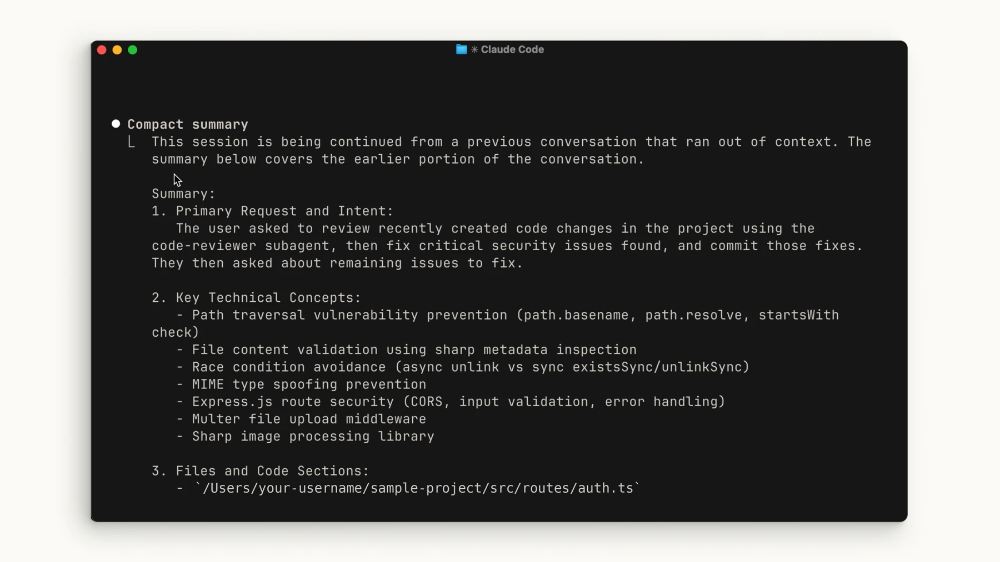

# Delegate long-running tasks to an agent

## 1. Define the finish line

Write the goal and acceptance criteria before starting. Do not mark a criterion done until you inspect evidence of the result.

## 2. Complete one step at a time

Break work into small parts and close each step with a test or other verifiable evidence.

## 3. Check the result yourself

Read the file changes, real execution, or report; an agent's claim alone is not proof.

## 4. Record handoff state

Keep changes, checks, open items, and next steps in a project note so another session can continue from the same point.

This adapts [Anthropic's long-running agent examples](https://github.com/anthropics/cwc-long-running-agents). Do not transfer Claude Code-specific hooks to another tool without checking compatibility.

## Illustrated example: preserve context in Claude Code

As a conversation grows, its summary should retain the goal, decisions, important files and pending work. The official example below shows compaction output; compare it with the actual project and keep a separate handoff note too.

[Session and context lesson](/learning/claude-sessions) · [Official image source](https://academy.claude.com/courses/claude-code-101/context-management)
