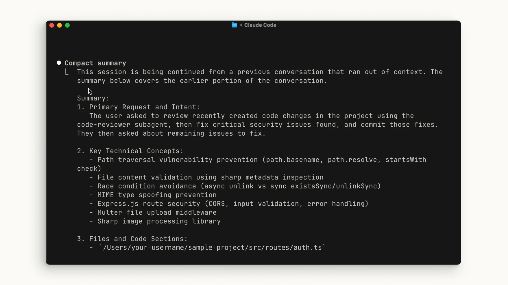

# واگذاری کارهای طولانی به ایجنت

## ۱. پایان را دقیق تعریف کنید

پیش از شروع، هدف و معیار پایان را بنویسید. هیچ موردی تا وقتی نتیجهٔ واقعی آن بررسی نشده، انجام‌شده نیست.

## ۲. هر بار یک گام کامل بردارید

کار را به بخش‌های کوچک تقسیم کنید و هر گام را با آزمون یا مدرک قابل بررسی ببندید.

## ۳. نتیجه را مستقل بسنجید

تغییر فایل، اجرای واقعی یا گزارش را بخوانید؛ به گفتهٔ ایجنت به‌تنهایی تکیه نکنید.

## ۴. وضعیت ادامه را ثبت کنید

تغییرها، بررسی‌ها، موارد باز و گام بعد را در یک یادداشت پروژه نگه دارید تا جلسهٔ بعد از همان‌جا ادامه دهد.

این الگو از مواد نمونهٔ [Anthropic برای ایجنت‌های طولانی‌مدت](https://github.com/anthropics/cwc-long-running-agents) اقتباس شده است؛ تنظیمات ویژهٔ Claude Code را بدون بررسی به ابزار دیگری منتقل نکنید.

## نمونهٔ تصویری: حفظ زمینه در Claude Code

وقتی گفتگو طولانی می‌شود، خلاصه باید هدف، تصمیم‌ها، فایل‌های مهم و موارد ناتمام را حفظ کند. تصویر رسمی زیر نمونهٔ خروجی فشرده‌سازی است؛ آن را با وضعیت واقعی پروژه تطبیق دهید و یادداشت ادامهٔ کار را هم نگه دارید.

[درس مدیریت گفتگو و زمینه](/learning/claude-sessions) · [منبع تصویری رسمی](https://academy.claude.com/courses/claude-code-101/context-management)
