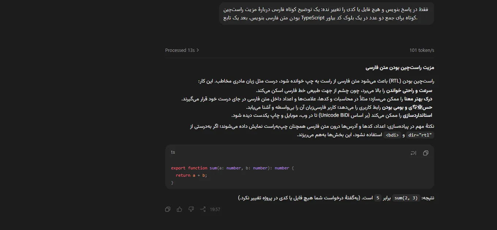

# MiniMax Code Desktop

## Install and launch
Install the Windows build from the [official MiniMax Code site](https://code.minimax.io/). Refresh its status in VibeHub; if it is not detected, choose the app executable and select `MiniMax Code.exe`.

The app keeps running in the tray when its window closes and allows only one instance. Before launching RTL, quit it fully from the tray menu, then choose “Launch with RTL” in VibeHub. If the app is already open without the RTL port, VibeHub tells you to close it first.

## Persian RTL
VibeHub applies the Vazirmatn font and automatic direction to chat text and the prompt composer; the application UI itself stays English. Verified in a live test on 2026-11-14 against version 3.1.15.221. Code blocks, terminals, and file previews stay left-to-right on purpose so source snippets remain intact. To leave RTL mode, close the app and launch it normally from VibeHub.

## Model and credits
Sign in with a MiniMax account. Daily sign-in credits provide free usage, and paid plans add quota; cost and limits follow your account. Change the model from the selector inside the app.

## Network and troubleshooting
If the app is installed in a custom location, choose its executable manually. VibeHub passes the proxy setting to the app, but proxy routing inside MiniMax Code has not been separately verified. After each app update, test one Persian message and one code block.
