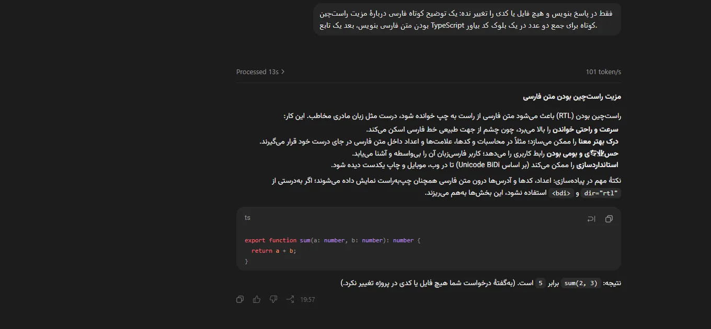

# MiniMax Code دسکتاپ

## نصب و اجرا
نسخهٔ ویندوز را از [سایت رسمی MiniMax Code](https://code.minimax.io/) نصب کنید. در وایب‌هاب وضعیت برنامه را تازه‌سازی کنید؛ اگر شناسایی نشد، «انتخاب مسیر برنامه» را بزنید و فایل `MiniMax Code.exe` را انتخاب کنید.

برنامه پس از بستن پنجره در tray می‌ماند و فقط یک نمونه اجرا می‌کند. برای اجرای RTL ابتدا از منوی tray کاملاً خارج شوید، سپس در وایب‌هاب «با RTL اجرا کن» را بزنید. اگر برنامه از قبل بدون پورت RTL باز باشد، وایب‌هاب همین را یادآوری می‌کند.

## RTL فارسی
وایب‌هاب فونت وزیرمتن و جهت خودکار را روی متن گفتگو و کادر درخواست اعمال می‌کند؛ رابط خود برنامه انگلیسی می‌ماند. تأییدشده با آزمون زندهٔ ۲۰۲۶/۱۱/۱۴ روی نسخهٔ 3.1.15.221. بلوک‌های کد، ترمینال و پیش‌نمایش فایل عمداً چپ‌به‌راست می‌مانند تا کد سالم بماند. برای خروج از حالت RTL، برنامه را ببندید و از اجرای عادی وایب‌هاب استفاده کنید.

## مدل و اعتبار
با حساب MiniMax وارد شوید. ورود روزانه اعتبار رایگان می‌دهد و پلن‌های اشتراکی سهمیهٔ بیشتری دارند؛ هزینه و محدودیت به حساب شما بستگی دارد. مدل را از انتخاب‌گر داخل برنامه عوض کنید.

## شبکه و عیب‌یابی
اگر برنامه در مسیر سفارشی نصب شده، فایل اجرایی را دستی انتخاب کنید. مسیر پروکسی در وایب‌هاب به برنامه داده می‌شود، اما کارکرد آن در MiniMax Code جداگانه تأیید نشده است. پس از هر به‌روزرسانی نسخهٔ برنامه، یک بار چت فارسی و یک بلوک کد را امتحان کنید.
