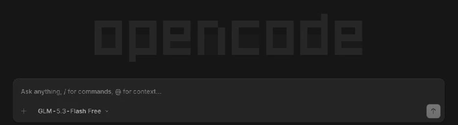
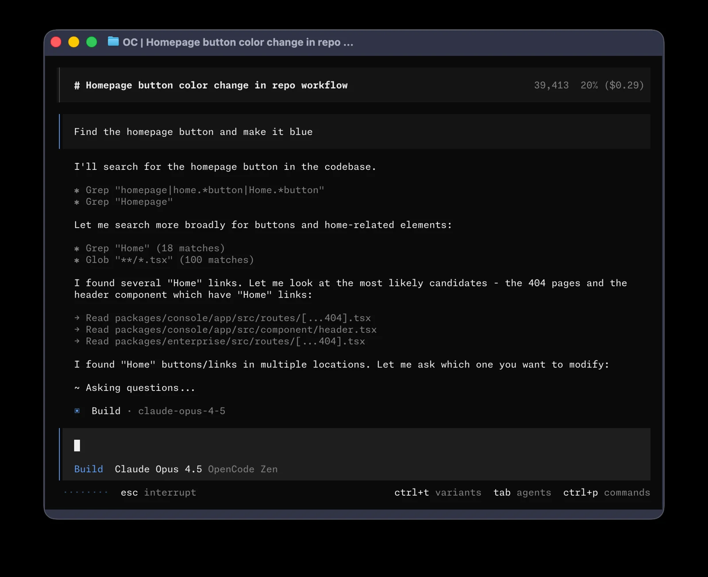

# OpenCode Desktop

## Install and launch
Install the desktop app from the [official website](https://opencode.ai/). Refresh its status in VibeHub; if it is not detected, choose the app executable and select OpenCode.exe. Launch the app and open your project folder inside it.

Open the model selector below the prompt and choose an available model. Start by asking for an explanation of a test file without editing it.

## Connect a model
Configure the provider and API key in OpenCode using its documentation. Saving or selecting an API in VibeHub alone does not connect the application. Pricing and quotas depend on the provider and model.

## Network and troubleshooting
Refresh after a new installation. For a custom installation, choose the executable manually. Proxy routing and RTL behavior in the desktop app have not been separately verified.

## Terminal interface comparison

