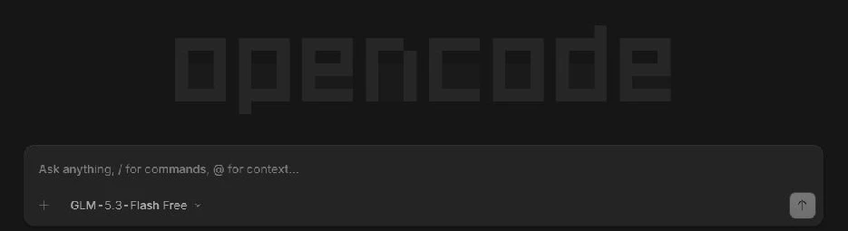
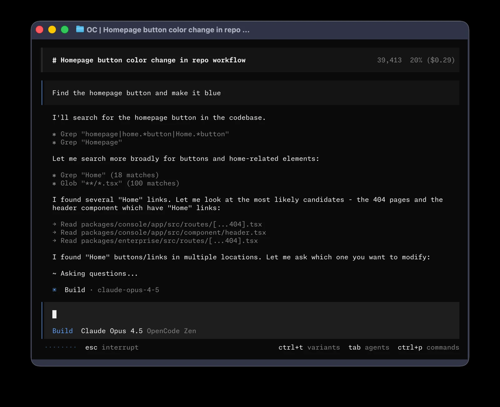

# OpenCode دسکتاپ

## نصب و اجرا
نسخهٔ دسکتاپ را از [وب‌سایت رسمی](https://opencode.ai/) نصب کنید. در وایب‌هاب وضعیت برنامه را تازه‌سازی کنید؛ اگر شناسایی نشد، «انتخاب مسیر برنامه» را بزنید و فایل OpenCode.exe را انتخاب کنید. سپس برنامه را اجرا و پوشهٔ پروژه را از داخل آن باز کنید.

نام مدل زیر کادر را باز کنید و مدل در دسترس را انتخاب کنید. برای شروع، توضیح یک فایل آزمایشی را بدون ویرایش آن بخواهید.

## اتصال مدل
ارائه‌دهنده و کلید API را طبق راهنمای OpenCode در خود برنامه تنظیم کنید. ذخیره یا انتخاب API در وایب‌هاب به‌تنهایی برنامه را متصل نمی‌کند. هزینه و سهمیه به ارائه‌دهنده و مدل بستگی دارد.

## شبکه و عیب‌یابی
پس از نصب جدید دوباره بررسی کنید. اگر برنامه در مسیر سفارشی است، فایل اجرایی را دستی انتخاب کنید. کارکرد پروکسی و نمایش RTL در نسخهٔ دسکتاپ جداگانه تأیید نشده‌اند.

## مقایسه با نسخهٔ ترمینال

