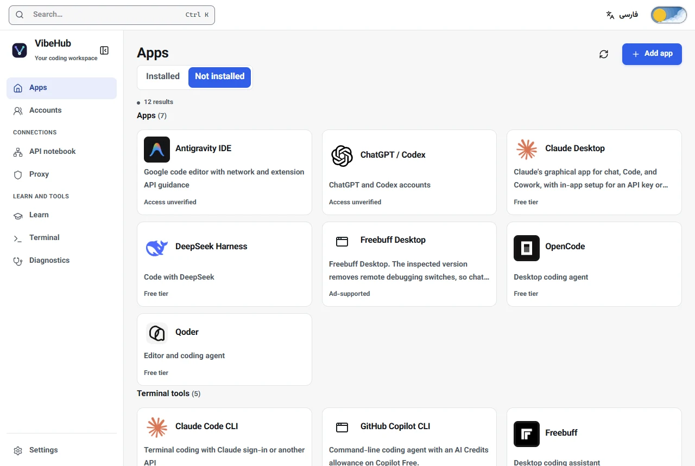

# Pi CLI

Pi is a minimal command-line coding agent: lightweight and fast, with the model of your choice (you bring the provider key).

Make sure Node.js is available, then run:

`npm install -g --ignore-scripts @earendil-works/pi-coding-agent`

In VibeHub, refresh the app list so Pi appears in the terminal tools group; launching it opens a terminal window.

[Official repository and docs](https://github.com/earendil-works/pi)
