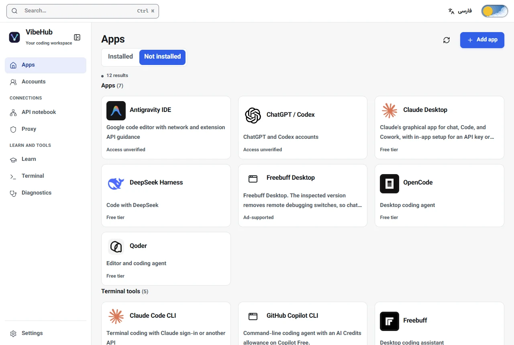

# Pi CLI

Pi یک عامل کدنویسی مینیمال خط فرمان است: سبک و سریع، و مدل را خودتان انتخاب می‌کنید (کلید هر ارائه‌دهنده را Pi مدیریت می‌کند).

ابتدا Node.js را داشته باشید و سپس فرمان زیر را اجرا کنید:

`npm install -g --ignore-scripts @earendil-works/pi-coding-agent`

در VibeHub فهرست برنامه‌ها را تازه‌سازی کنید تا Pi در گروه ابزارهای ترمینال دیده شود؛ اجرای آن یک پنجرهٔ ترمینال باز می‌کند.

[مخزن رسمی و راهنما](https://github.com/earendil-works/pi)
