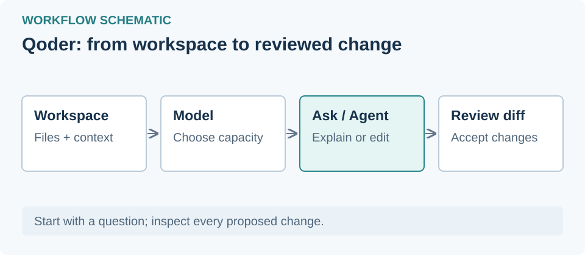

# Qoder — learn the interface and use free model allowances

English | [فارسی](fa.md)

## 0. Learning path and product choice — beginner

Follow lessons 1–6 in order; 7–8 are intermediate. Outcome: open a project, recognize the interface, complete a small task, and check both cost and output.

**Qoder IDE** provides a code editor; **Qoder** organizes Agent tasks. Their layouts differ. Read the lesson for your product. Sources checked **November 1, 2026**; this is documentation review, not an authenticated account test.

## 1. Install, sign in and open a project — beginner

Download your product from the [official site](https://qoder.com/download) and sign in. Create a practice folder containing `hello.txt` with the text “Hello”.

- **Qoder IDE:** Open the folder; Ctrl+L opens Chat on Windows.
- **Qoder:** Choose Coding at the upper left and add the folder as a workspace.

Checkpoint: confirm the intended folder and open your file. [IDE quick start](https://docs.qoder.com/quick-start) · [Qoder quickstart](https://docs.qoder.com/qoder/quickstart)

## 2. Recognize Qoder IDE — beginner

Locate the file list, the editor showing your file, and Chat (Ctrl+L). Find the composer, history, mode and model controls.

**Ask** answers questions without editing code. **Agent** can search, edit files and use tools. Practice in Ask: “Explain hello.txt; do not change anything.” Check that the answer concerns your file and its contents remain unchanged. [Interface and modes](https://docs.qoder.com/user-guide/chat/overview)

## 3. Recognize Qoder desktop — beginner

**Coding** organizes work by workspace; **General** by folder. Find your tasks in the sidebar. Below the composer, check the model and access permissions. **Local** uses the current folder; **Worktree** makes a separate working copy for supported Git repositories.

Start with **Ask every time**. Request: “Read hello.txt and explain it without changing it.” Check the selected workspace. [Official quickstart](https://docs.qoder.com/qoder/quickstart)

## 4. Choose a free model and check cost — beginner

Open the model picker near the composer and explicitly select a model. Read its **current rate and Free badge before sending**. A listed model is not necessarily free. Avoid Auto for this exercise so that your intended model is explicit. [IDE selector](https://docs.qoder.com/user-guide/chat/model-tier-selector) · [Qoder selector](https://docs.qoder.com/qoder/model-selector)

Status on November 1, 2026:

- **Qwen3.8-Flash:** Daily free allowance for International individual accounts, including Free accounts with zero Credits. Extended; no end date announced.
- **DeepSeek-Flash:** Published deadline: November 1, 00:00 Singapore / October 31, 19:30 Tehran. It has passed; do not assume an extension.
- **Efficient:** Free access depends on account eligibility; do not assume every Free account qualifies.

For Qwen3.8-Flash, select it without claiming anything. The allowance is limited; continued use after exhaustion can consume Credits. Some features call other models with separate charges. [Qwen terms](https://docs.qoder.com/events/flashoffer) · [DeepSeek terms](https://docs.qoder.com/events/deepseek-flash-free)

Checkpoint: verify the chosen model and current rate, send one short request and inspect Usage. Stop if the free rate or allowance is unavailable.

## 5. Daily Credits versus a free model — beginner

Gift Credits are a spendable balance; an eligible free model call does not consume Credits within its allowance. In **Qoder desktop**, open Usage → gift icon and manually claim 100 Credits. Eligible International individual accounts qualify; Teams and Enterprise do not.

The window starts daily at 10:00 Singapore / **05:30 Tehran**. Each claimed batch expires after 30 days. On the website, avatar → Settings → Usage shows Add-on Credits. Terms can change. [Official offer](https://docs.qoder.com/events/100credits)

## 6. Make and verify one small change — practical

Use Agent in IDE, or a Coding task in Qoder. Recheck the model and rate, then request:

> Add only the line “My first Qoder exercise” to hello.txt. Change no other file. Explain the change and how you checked it.

Read the actual file and compare it with your request. Pass when that single line appears in the intended file. For real code, run relevant tests or builds too; review before committing.

## 7. Bring your own API key — intermediate

BYOK follows the provider account's pricing and allowances; it does not guarantee free usage. In IDE, open Qoder IDE Settings → Models → + Add, choose provider/model, supply your key, verify, then select it in Chat. Repo Wiki can consume Qoder Credits separately. [Custom models](https://docs.qoder.com/user-guide/chat/custom-models)

“DeepSeek 网页登录（免费模型）” belongs to **DeepSeek Harness**. Do not install it in Qoder; find its tutorial in VibeHub's plugins and skills page.

## 8. VibeHub, RTL and troubleshooting — intermediate

After installation, rescan in VibeHub. Install RTL prepares a shortcut; see the [RTL guide](https://github.com/ahmadkhanloo/VibeHub/blob/main/docs/tutorials/rtl-setup.en.md).

- **Missing model:** check product version, account and available models.
- **Credits deducted:** inspect Usage, allowance, actual model, Auto and features with separate model calls.
- **Login/network error:** see [Qoder troubleshooting](https://docs.qoder.com/qoder/troubleshooting).
- **RTL launch failure:** inspect VibeHub's error and Doctor; fully close an already-running app before relaunching.
