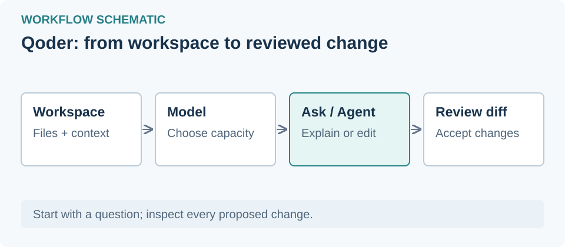

# Qoder — از شناخت محیط تا استفاده از مدل رایگان

فارسی | [English](en.md)

## ۰. مسیر یادگیری و انتخاب نسخه — مقدماتی

از درس ۱ تا ۶ به‌ترتیب جلو بروید؛ درس ۷ و ۸ تکمیلی‌اند. هدف: پروژه را باز کنید، محیط را بشناسید، یک درخواست کوچک بفرستید و هزینه و نتیجه را بررسی کنید.

دو محصول داریم: **Qoder IDE** با ویرایشگر کد، و **Qoder** با محیط کارهای ایجنتی. چیدمان این دو یکی نیست؛ درس مربوط به برنامهٔ خودتان را بخوانید. بررسی منابع: **۱ نوامبر ۲۰۲۶**؛ این متن گزارش آزمون حساب واقعی نیست.

## ۱. نصب، ورود و بازکردن پروژه — مقدماتی

از [سایت رسمی](https://qoder.com/download) محصول موردنظر را نصب و با حساب خود وارد شوید. برای تمرین یک پوشهٔ کوچک بسازید و فایل `hello.txt` با متن «سلام» در آن بگذارید.

- **Qoder IDE:** با Open پوشه را باز کنید؛ برای گفت‌وگو در ویندوز Ctrl+L را بزنید.
- **Qoder:** حالت Coding را از بالا سمت چپ انتخاب و پوشه را به workspace اضافه کنید.

معیار پایان: نام پوشهٔ درست را در برنامه ببینید و فایل تمرین را باز کنید. [شروع IDE](https://docs.qoder.com/quick-start) · [شروع Qoder](https://docs.qoder.com/qoder/quickstart)

## ۲. شناخت محیط Qoder IDE — مقدماتی

- **فهرست فایل‌ها:** نام و پوشهٔ فایل تمرین را پیدا کنید.
- **ویرایشگر:** فایل بازشده را بخوانید؛ نتیجهٔ تغییرات اینجا دیده می‌شود.
- **پنل Chat:** با Ctrl+L باز می‌شود؛ تاریخچه، کادر درخواست، حالت و انتخاب مدل را پیدا کنید.
- **Ask:** برای توضیح و سؤال دربارهٔ کد؛ فایل را تغییر نمی‌دهد.
- **Agent:** برای اجرای کار با جست‌وجو، ویرایش فایل و ابزارها.

تمرین: Ask را انتخاب کنید و بپرسید «این فایل چه محتوایی دارد؟ فعلاً چیزی را تغییر نده.» معیار پایان: پاسخ مربوط به همان فایل باشد و متن فایل تغییر نکرده باشد. [راهنمای محیط و حالت‌ها](https://docs.qoder.com/user-guide/chat/overview)

## ۳. شناخت محیط Qoder دسکتاپ — مقدماتی

- **Coding / General:** اولی کارها را بر اساس workspace کدنویسی و دومی بر اساس پوشه مرتب می‌کند.
- **نوار کناری:** کارهای مربوط به پروژه را پیدا و ادامه دهید.
- **کادر پیام:** هدف را بنویسید؛ پایین آن مدل و سطح دسترسی را بررسی کنید.
- **Local / Worktree:** Local در پوشهٔ فعلی کار می‌کند؛ Worktree برای مخزن Git پشتیبانی‌شده نسخهٔ کاری جدا می‌سازد.

برای شروع Ask every time را انتخاب کنید. تمرین: «فایل hello.txt را بخوان و توضیح بده؛ تغییر نده.» معیار پایان: کار در workspace درست باشد. [شروع رسمی](https://docs.qoder.com/qoder/quickstart)

## ۴. انتخاب مدل رایگان و کنترل هزینه — مقدماتی

انتخاب‌گر مدل کنار کادر پیام را باز کنید، مدل مشخص را انتخاب کنید و **پیش از ارسال، نرخ فعلی و نشان Free را بخوانید**. دیدن نام مدل در فهرست، اثبات رایگان‌بودن نیست. برای این تمرین Auto را انتخاب نکنید؛ مدل موردنظر را صریح انتخاب کنید. [انتخاب مدل در IDE](https://docs.qoder.com/user-guide/chat/model-tier-selector) · [انتخاب مدل در Qoder](https://docs.qoder.com/qoder/model-selector)

وضعیت در ۱ نوامبر ۲۰۲۶:

- **Qwen3.8-Flash:** سهمیهٔ روزانهٔ رایگان برای حساب شخصی International، حتی Free با اعتبار صفر؛ تمدید شده و تاریخ پایان اعلام نشده است.
- **DeepSeek-Flash:** مهلت اعلام‌شده ۱ نوامبر ساعت ۰۰:۰۰ سنگاپور، برابر ۳۱ اکتبر ساعت ۱۹:۳۰ تهران بود؛ گذشته است. بدون اعلام تمدید، رایگان حساب نکنید.
- **Efficient:** رایگان‌بودن به واجدشرایط‌بودن حساب وابسته است؛ برای همهٔ کاربران Free فرض نکنید.

برای Qwen3.8-Flash دریافت دستی لازم نیست؛ مدل را انتخاب کنید. سهمیه محدود است و پس از اتمام، ادامه می‌تواند اعتبار مصرف کند. فراخوانی مدل‌های دیگر توسط بعضی قابلیت‌ها جدا هزینه دارد. [شرایط Qwen](https://docs.qoder.com/events/flashoffer) · [شرایط DeepSeek](https://docs.qoder.com/events/deepseek-flash-free)

معیار پایان: نام مدل انتخاب‌شده و نرخ فعلی را ببینید؛ یک پیام کوتاه بفرستید و Usage را بررسی کنید. اگر نرخ رایگان یا سهمیه موجود نیست، ارسال را متوقف کنید.

## ۵. هدیهٔ روزانه با مدل رایگان چه فرقی دارد؟ — مقدماتی

اعتبار هدیه موجودی قابل‌مصرف است؛ مدل رایگان در محدودهٔ سهمیه، اعتبار مصرف نمی‌کند. در Qoder دسکتاپ، Usage → آیکون هدیه را باز و ۱۰۰ اعتبار را دستی دریافت کنید. حساب شخصی International واجد شرایط است؛ Teams و Enterprise شامل نیستند.

بازهٔ روزانه از ۱۰:۰۰ سنگاپور، برابر **۰۵:۳۰ تهران** شروع می‌شود. هر بسته پس از ۳۰ روز منقضی می‌شود. موجودی در وب‌سایت، تصویر حساب → Settings → Usage → Add-on Credits دیده می‌شود. شرایط ممکن است عوض شود. [منبع رسمی](https://docs.qoder.com/events/100credits)

## ۶. اولین تغییر کوچک و بررسی نتیجه — کاربردی

در IDE حالت Agent، یا در Qoder یک کار Coding باز کنید. قبل از ارسال، مدل و نرخ را دوباره ببینید. این درخواست را بنویسید:

> فقط در hello.txt یک خط «اولین تمرین من با Qoder» اضافه کن. فایل دیگری را تغییر نده. در پایان بگو چه چیزی تغییر کرد و چگونه بررسی‌اش کردی.

تغییر فایل را خودتان بخوانید و با درخواست مقایسه کنید. معیار پایان: همان یک خط در همان فایل اضافه شده باشد. برای پروژهٔ واقعی، آزمون یا build مرتبط را هم اجرا کنید. ثبت commit را پس از بررسی انجام دهید.

## ۷. کلید شخصی و مدل سفارشی — تکمیلی

BYOK یعنی پرداخت و سهمیه طبق حساب ارائه‌دهندهٔ API است؛ رایگان‌بودن را تضمین نمی‌کند. در IDE از Qoder IDE Settings → Models → + Add ارائه‌دهنده، مدل و کلید را وارد کنید؛ پس از بررسی اتصال، آن را در Chat انتخاب کنید. Repo Wiki ممکن است جداگانه اعتبار Qoder مصرف کند. [مستندات مدل سفارشی](https://docs.qoder.com/user-guide/chat/custom-models)

افزونهٔ «DeepSeek 网页登录（免费模型）》 برای **DeepSeek Harness** است؛ آن را در Qoder نصب نکنید. راهنمایش در بخش پلاگین و اسکیل VibeHub است.

## ۸. اجرا با VibeHub، RTL و رفع مشکل — تکمیلی

پس از نصب، در VibeHub «بررسی دوباره» را بزنید. «نصب RTL» میانبر آماده می‌کند؛ برای جزئیات [راهنمای RTL](https://github.com/ahmadkhanloo/VibeHub/blob/main/docs/tutorials/rtl-setup.fa.md) را ببینید.

- **مدل دیده نمی‌شود:** نسخه، حساب و فهرست مدل‌های همان محصول را بررسی کنید.
- **اعتبار کم شده:** Usage را بخوانید؛ سهمیه، مدل واقعی، Auto و قابلیت‌های دارای مدل جدا را بررسی کنید.
- **ورود یا اتصال خطا دارد:** [عیب‌یابی Qoder](https://docs.qoder.com/qoder/troubleshooting) و تنظیمات شبکه را ببینید.
- **اجرای RTL خطا دارد:** پیام VibeHub و Doctor را بررسی کنید؛ اگر برنامه از قبل باز است، کامل ببندید و دوباره اجرا کنید.
