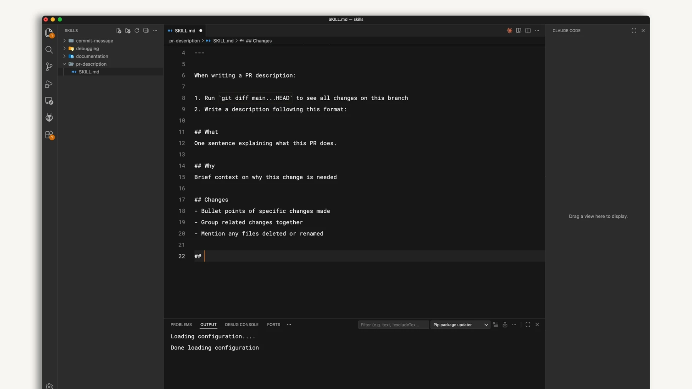
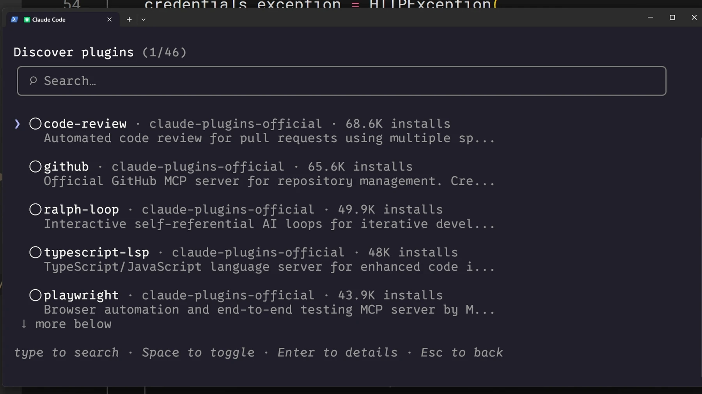
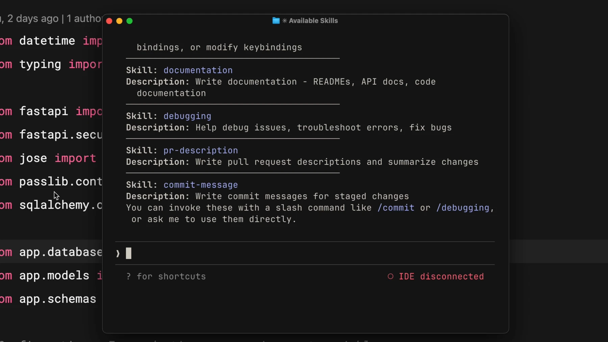

# Install and manage skills and plugins

## Know the format

A skill is reusable workflow guidance for an agent. A plugin may bundle skills and connected tools. An editor extension installs inside an editor such as VS Code and follows a separate path. A shared format does not guarantee support in every host.

## Check compatibility and access

Read the source for supported hosts, versions, sign-in needs, and workspace permissions. Plugin availability alone does not guarantee support in every Codex or ChatGPT version. Connected services also have their own regional and account terms.

## Install carefully

Review the source and project files before installation; check requested access. In Codex, use the host's official skill installation guide or package manager. Get editor extensions from the editor's official marketplace. Guide commands are never run automatically.

## Use and maintain

Choose a skill that fits the task and point the agent to relevant files. If it does not appear, check the `SKILL.md` location, host support, and its prerequisites. A new session may be needed after configuration changes.

When removing an item, remove only its own folder or connection and check for project files and access separately. Use a plugin's Uninstall option when provided. Removing a plugin may not sign you out.

