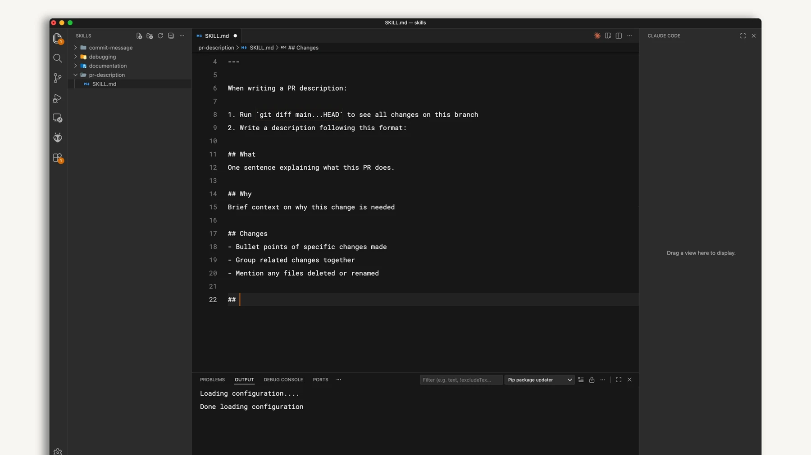
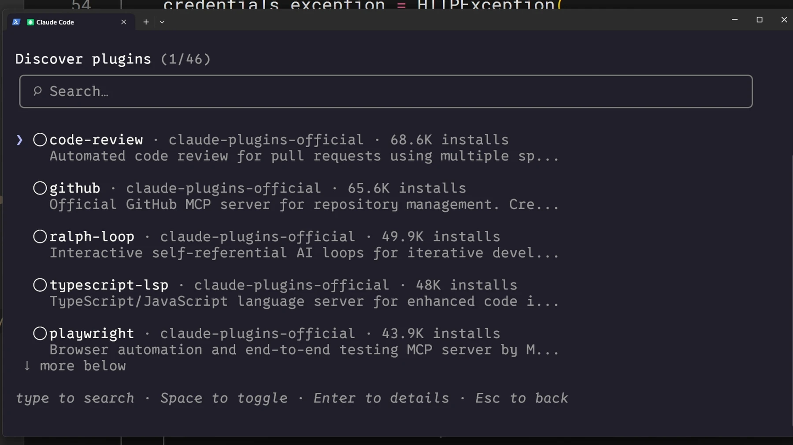
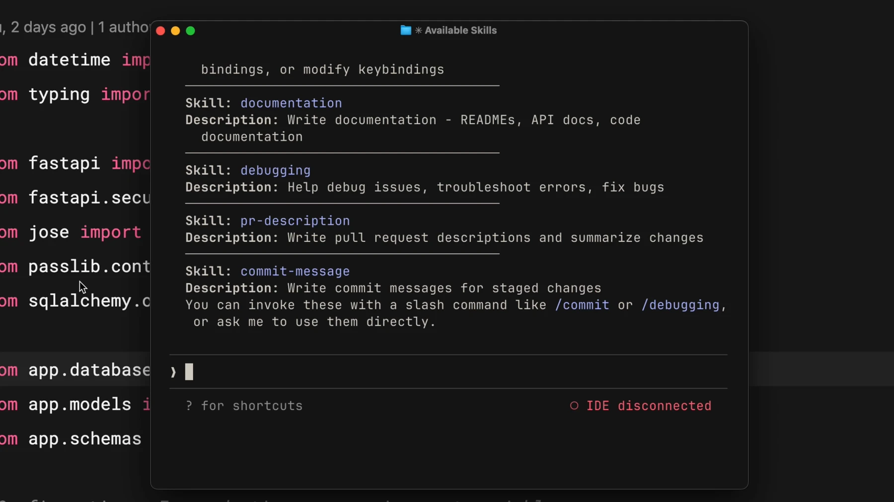

# نصب و مدیریت اسکیل‌ها و افزونه‌ها

## تفاوت قالب‌ها

اسکیل راهنمای کارِ قابل‌استفادهٔ دوباره برای عامل است. پلاگین ممکن است چند اسکیل و ابزار اتصال داشته باشد. افزونهٔ ویرایشگر داخل محیطی مانند VS Code نصب می‌شود و مسیر جداگانه دارد؛ قالب یکسان به معنی سازگاری همهٔ میزبان‌ها نیست.

## سازگاری و دسترسی

نام میزبان، نسخهٔ سازگار، نیاز به ورود و مجوز فضای کاری را در منبع اصلی بررسی کنید. دسترسی قابلیت پلاگین به‌تنهایی پشتیبانی آن را در هر نسخهٔ Codex یا ChatGPT تضمین نمی‌کند. خدمات متصل نیز شرایط منطقه‌ای و حساب جدا دارند.

## نصب با احتیاط

پیش از نصب، منبع و فایل‌های پروژه را بخوانید و دسترسی‌های لازم را بررسی کنید. در Codex از راهنمای نصب اسکیل یا مدیر بستهٔ رسمی همان میزبان استفاده کنید. افزونهٔ ویرایشگر را از مخزن رسمی همان ویرایشگر بگیرید. فرمانهای راهنما خودکار اجرا نمی‌شوند.

## استفاده و نگهداری

اسکیل را برای کاری متناسب انتخاب کنید و فایل‌های لازم را به عامل معرفی کنید. اگر اسکیل دیده نمی‌شود، مسیر `SKILL.md`، پشتیبانی میزبان و پیش‌نیازهای خود اسکیل را بررسی کنید. ممکن است پس از تغییر پیکربندی به شروع دوبارهٔ نشست نیاز باشد.

برای حذف، فقط پوشه یا اتصال متعلق به همان افزونه را بردارید؛ فایل‌ها و دسترسی‌های مربوط به پروژه را جداگانه بررسی کنید. اگر پلاگین گزینهٔ Uninstall دارد از همان گزینه استفاده کنید. حذف افزونه ممکن است نشست حساب شما را نبندد.

