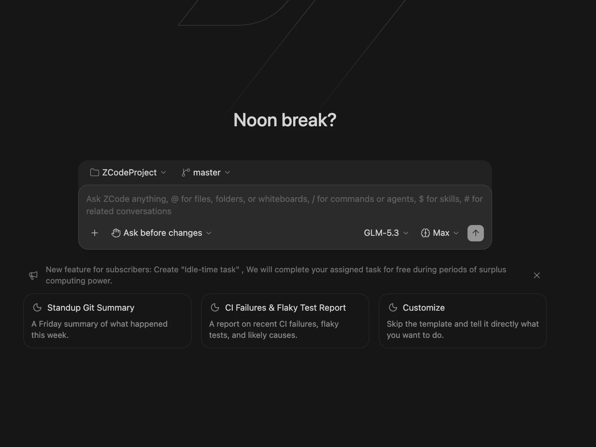
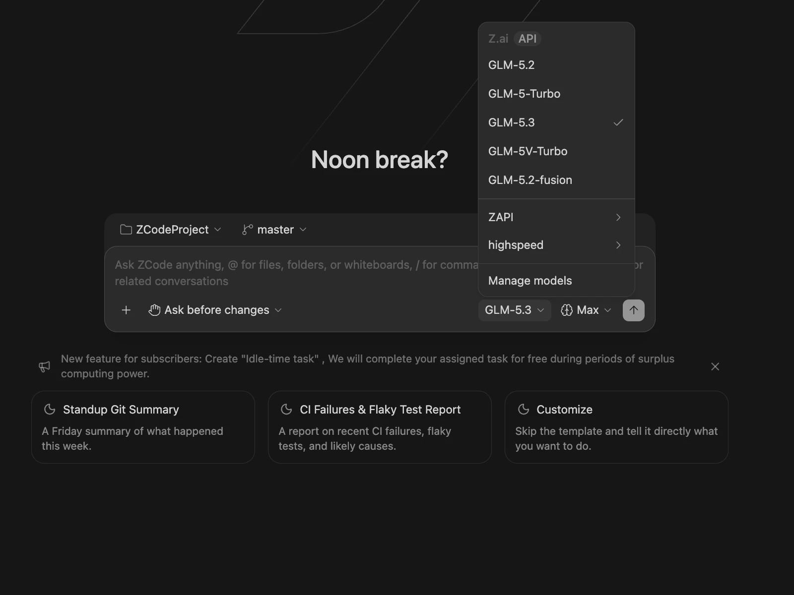
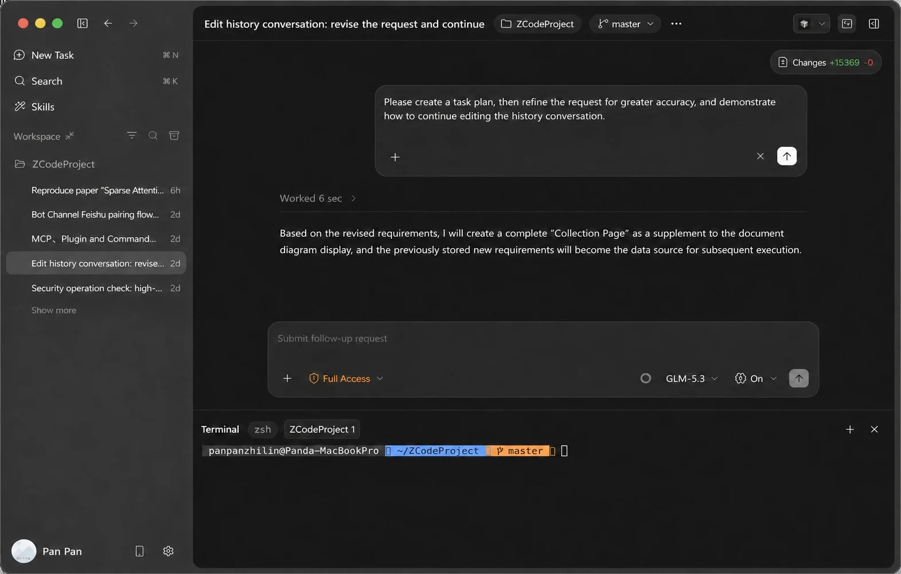

# ZCode — English guide

## Introduction
ZCode is an AI coding agent/IDE used with a user account. VibeHub discovers it, launches it, and injects RTL so Persian text renders correctly.

## Free access
- The free path comes with provider-defined terms and quotas; check the [official site](https://zcode.z.ai/) for the current status.
- "Free" does not mean "open source"; the ZCode application is not open source.
- Quotas change — VibeHub never hard-codes quota numbers.

## Install
1. Get the official installer from the vendor (the "Official download" button on the details page; it is separate from the optional invite link).
2. After installing, VibeHub auto-detects standard install locations.
3. No Node.js requirement for you — the RTL engine ships inside VibeHub.

## First run
1. In **My Apps**, click **Launch with RTL**.
2. VibeHub starts the app with a local debugging port and activates the RTL injector.
3. Run **Doctor** to verify the RTL state end-to-end.

## Proxy & Iran access
- Direct access status: **not tested**. If the connection fails, configure your local proxy profile in the Proxy Center.
- Launching through a proxy does not guarantee all app traffic is tunneled; respect the provider's policies.

## RTL
- Status: **verified** (live test 2026-10-18, version 3.15.3). Persian text right-aligns; code/terminal stay LTR.
- If the app is already running, fully quit it (including the system tray) and relaunch from VibeHub.

## Troubleshooting
- **RTL not applied:** Doctor → check port 9222 and injector status.
- **Port busy:** pick another port in settings or close the occupying app.
- **App launched without RTL:** fully quit, then launch again via VibeHub.

## Model options
Models and quotas come from the provider; BYOK status is "unknown" until tested in a later release.

## Shared RTL setup

See the [Persian text and RTL guide](/learning/rtl-setup) for common installation, launch and recovery steps. This app's verification status remains in the RTL section above.

## Illustrated exercise: project, model and request correction

1. Choose a disposable project folder. Check its name and branch above the composer. For this exercise, choose Ask before changes and request only an explanation of hello.txt.

2. Open the model name and choose a model available through your connection. Manage models opens provider configuration. The screenshot's models and example account allowance do not describe your own account.

3. To correct the latest request, wait for execution to finish, hover your own message and choose the pencil icon. Revise the text or path and inspect the effects on files before sending again. Editing the latest turn can be unavailable while work is running or messages are queued.

[Official getting started guide](https://zcode.z.ai/en/docs/welcome) · [Model configuration](https://zcode.z.ai/en/docs/configuration) · [Edit history](https://zcode.z.ai/en/docs/edit-history)
