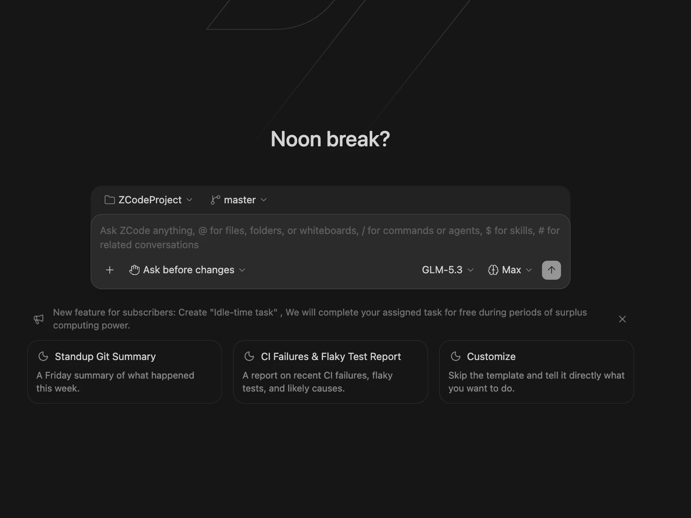
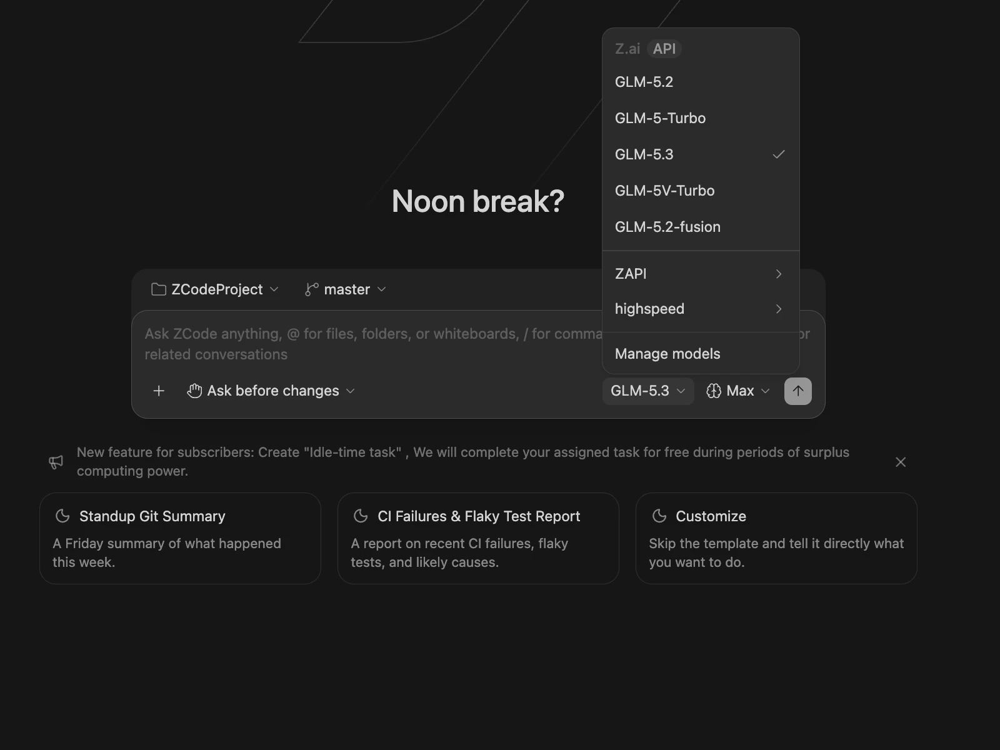
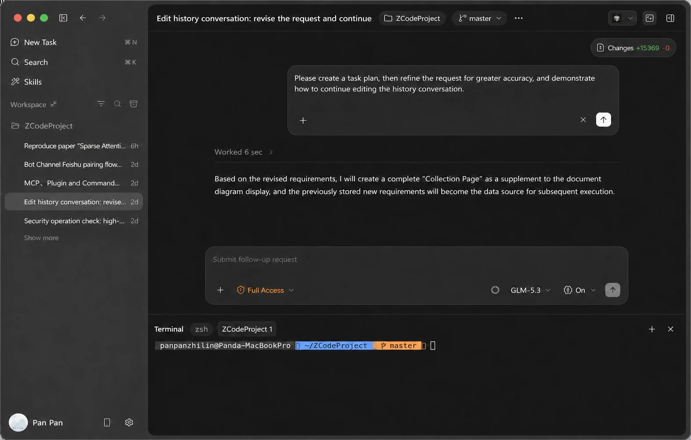

# ZCode — راهنمای فارسی

## معرفی
ZCode یک ایجنت/IDE کدنویسی با هوش مصنوعی است که از طریق حساب کاربری قابل استفاده است. VibeHub این ابزار را کشف، اجرا و با تزریق RTL برای متن فارسی آماده می‌کند.

## دسترسی رایگان
- مسیر رایگان با شرایط و سهمیهٔ متغیر سرویس‌دهنده همراه است؛ آخرین وضعیت را در [سایت رسمی](https://zcode.z.ai/) ببینید.
- «رایگان» به معنی «متن‌باز» نیست؛ نرم‌افزار ZCode متن‌باز نیست.
- سهمیه‌ها ممکن است تغییر کنند؛ VibeHub عدد سهمیه را در کد ثبت نمی‌کند.

## نصب
1. نصب‌کنندهٔ رسمی را از سایت سازنده دریافت کنید (دکمهٔ «دانلود رسمی» در صفحهٔ جزئیات، مسیر مستقل از لینک دعوت است).
2. پس از نصب، VibeHub به‌طور خودکار نصب را در مسیرهای استاندارد تشخیص می‌دهد.
3. نیاز به Node.js برای کاربر نهایی نیست؛ موتور RTL همراه VibeHub است.

## اولین اجرا
1. در «برنامه‌های من» روی **اجرا با RTL** بزنید.
2. VibeHub برنامه را با پورت اشکال‌زدایی محلی راه‌اندازی و تزریق‌کنندهٔ RTL را فعال می‌کند.
3. برای اطمینان، «Doctor» را اجرا کنید تا وضعیت RTL را راستی‌آزمایی کند.

## پروکسی و دسترسی از ایران
- وضعیت دسترسی مستقیم: **آزمون‌نشده** (Not tested). اگر اتصال برقرار نشد، می‌توانید پروفایل پروکسی محلی خود را در «مرکز پروکسی» تنظیم کنید.
- استفاده از پروکسی تضمین نمی‌کند همهٔ ترافیک برنامه تونل شود؛ سیاست‌های سرویس‌دهنده را رعایت کنید.

## RTL
- وضعیت: **تأییدشده** (آزمون زندهٔ ۲۰۲۶/۱۰/۱۸ روی نسخهٔ 3.15.3). متن فارسی راست‌چین می‌شود و کد/ترمینال چپ می‌ماند.
- اگر برنامه از قبل باز است، آن را کامل (شامل system tray) ببندید و دوباره با میانبر RTL اجرا کنید.

## عیب‌یابی
- **RTL اعمال نمی‌شود:** Doctor → بررسی پورت 9222 و وضعیت تزریق‌کننده.
- **پورت اشغال است:** پورت دیگری از تنظیمات انتخاب کنید یا برنامهٔ متصرف را ببندید.
- **برنامه بدون RTL باز بود:** بستن کامل و اجرای دوباره با VibeHub.

## گزینه‌های مدل
مدل‌ها و سهمیه‌ها از سرویس‌دهنده می‌آیند؛ برای BYOK وضعیت «نامشخص» است تا در نسخه‌های بعد آزمون شود.

## راه‌اندازی مشترک RTL

مراحل نصب، اجرا و رفع خطای مشترک برنامه‌های پشتیبانی‌شده در [راهنمای فارسی‌نویسی و RTL](/learning/rtl-setup) آمده است. وضعیت تأیید همین برنامه در بخش RTL بالا آمده است.

## تمرین تصویری: پروژه، مدل و اصلاح درخواست

۱. یک پوشهٔ آزمایشی را به‌عنوان پروژه انتخاب کنید. پیش از ارسال درخواست، نام پروژه و شاخه را در بالای کادر پیام بررسی کنید. برای تمرین، حالت Ask before changes را انتخاب کنید و فقط توضیح فایل hello.txt را بخواهید.

۲. نام مدل را باز کنید. مدل مناسبِ اتصال خودتان را انتخاب کنید؛ Manage models مسیر تنظیم ارائه‌دهنده‌هاست. نام مدل‌های تصویر و سهمیهٔ حساب نمونه را به حساب خود تعمیم ندهید.

۳. اگر درخواست آخر اشتباه بود، پس از پایان کار نشانگر را روی پیام خودتان ببرید و آیکون مداد را انتخاب کنید. متن و مسیر را اصلاح کنید و پیش از ارسال دوباره، اثر تغییر روی فایل‌ها را بررسی کنید. هنگام اجرای کار یا وجود پیام در صف، ویرایش آخرین نوبت ممکن است در دسترس نباشد.

[شروع رسمی ZCode](https://zcode.z.ai/en/docs/welcome) · [تنظیم مدل‌ها](https://zcode.z.ai/en/docs/configuration) · [ویرایش تاریخچه](https://zcode.z.ai/en/docs/edit-history)
